# Rogue Tower — contenido, arte y assets

Este documento reúne catálogos humanos, nombres, campaña, rutas visuales, proceso artístico y fuentes de referencia. Para reglas de juego activas consulta PROJECT_SPEC.md; para el estado de instalación y verificación consulta IMPLEMENTATION_AND_QA.md. Las tablas de arte fechadas son snapshots; código y Resources determinan las rutas y dimensiones que carga el juego hoy.

## Índice

- [Contenido inicial](#initial-content)
- [Nombres canónicos](#canonical-names)
- [Roster](#content-roster)
- [Campaña de 45 rondas](#campaign)
- [Auditorías de contenido](#tower-audit)
- [Sprites actuales](#sprite-catalog)
- [Proceso e historial de arte](#art-process)
- [Referencias externas](#external-references)
- [Importación inicial archivada](#initial-import)

<a id='initial-content'></a>
## Contenido inicial y procedencia de placeholders

Los nombres visibles siguen la nomenclatura aprobada. Los parámetros base de las siete torres y los perfiles normales de enemigos adoptan los valores publicados de Rogue Tower; las diferencias respecto a la wiki se corrigen con el changelog oficial. El progreso propio, los encuentros especiales y las composiciones de oleada sin dato publicado conservan sus reglas y valores configurables.

### Roster jugable de la DEMO

Por petición del usuario, los seis arquetipos aprobados y Shredder forman el roster jugable de esta demo. Sus parámetros base de Rogue Tower se adoptan según el catálogo y ADR-0036. Las reglas propias de niveles, cartas y costes de mejora que no estén publicadas o aprobadas se mantienen configurables en `data/towers/*.tres`.

| Atajo | Nombre canónico | Gameplay disponible |
|---:|---|---|
| 1 | Ballista | Un objetivo, versátil. |
| 2 | Mortar | Proyectil de largo alcance con explosión de área, mayor respuesta contra `Armor`. |
| 3 | Tesla Coil | Descarga arcana a todos los enemigos dentro del alcance; consume `Mana` por descarga. |
| 4 | Frost Keep | Copos sobre PATH: cada impacto daña a un enemigo y aplica `Slow`; consume `Mana` de forma continua. |
| 5 | Flame Thrower | Cono de fuego y `Burn` periódico; consume `Mana`. |
| 6 | Poison Sprayer | Cono de veneno y `Poison` periódico; consume `Mana`. |
| 7 | Shredder | Hoja que alcanza al objetivo, sigue `Path`, golpea cada enemigo una vez, pierde 1 de daño base por impacto y convierte el daño restante en `Bleed`. |

`TowerData` configura patrón de ataque, radio/ángulo/límite de objetivos, cadencia, costes, multiplicadores `Health`/`Armor`/`Shield`, tipo y color placeholder. Ballista usa proyectil de objetivo único; Mortar proyectil con explosión; Tesla Coil descarga contra todos los objetivos en su alcance circular; Frost Keep deja caer copos sobre PATH dentro de un cuadrado y aplica daño y `Slow` solo al contacto; Flame Thrower y Poison Sprayer afectan un cono y convierten el 100% de su daño base en `Burn`/`Poison`; Shredder recorre `Path`. Shredder hace daño directo según la capa activa y además añade `Bleed` por el 100% del daño base restante de la hoja por enemigo (10, 9, 8…), perdiendo 1 de daño base por impacto. Todo pasa por `DamageService`; ADR-0023 documenta las reglas completas, con las reglas Frost sustituidas parcialmente por ADR-0059, y reemplaza las partes obsoletas de ADR-0014/0015. Armor Piercing Bolt, Sapping Bolt y Status Probe siguen seleccionables en runtime con `8`, `9` y `0`; son perfiles de diagnóstico y no parte del roster reclutable. Las antiguas oleadas/dummies DEBUG de M7/M8 ya no forman parte del juego ni de la aceptación vigente (retirados en M64); las capas y estados se observan en enemigos de campaña. Ooogie von Ooogovich usa su balance propio, convoca dos Bats y entra en su fase Bat al morir; la limpieza de ronda y su recompensa esperan la derrota final. No hay Support Buildings.

#### Valores de referencia y adaptación

La tabla de referencia define los perfiles de base adoptados para las siete torres, salvo el ajuste propio de Tesla Coil. Frost Keep vuelve a las cifras de referencia y al comportamiento de copos mediante ADR-0059. Los Resources siguen editables; costes, escalado por niveles, umbrales de XP, áreas y parámetros visuales de caída/contacto no fijados permanecen configurables.

| Torre | Daño | Multiplicador H/A/S | Alcance | RPM | Mana | Precio base (+incremento) |
|---|---:|---:|---:|---:|---|---:|
| Ballista | 10 | 10/5/5 | 5 | 20 | — | 10 (+15) |
| Mortar | 20 | 10/15/5 | 10 | 10 | — | 200 (+75) |
| Tesla Coil | 9 | 6/3/10 | 2 | 30 | 5/ataque | 200 (+75) |
| Frost Keep | 6 | 10/5/5 | 2, cuadrado | 180 + 18 por PATH cubierto | 2/s continuo durante combate | 250 (+100) |
| Flame Thrower | 6 | 6/9/3 | 4 | 60 | 1/ataque | 300 (+75) |
| Poison Sprayer | 5 | 6/3/9 | 4 | 60 | 1/ataque | 300 (+75) |
| Shredder | 10 | 20/10/10 | 5 | 5 | — | 500 (+100) |

Frost Keep usa daño base 6 y 180 RPM: cada copo cae sobre PATH, daña un solo enemigo al contacto y convierte el 50% del daño aplicado en Slow (fuerza máxima 60, decae 6/s). Su coste es 2 Mana/s continuo durante combate. Tesla Coil mantiene daño base 9 como balance propio provisional de ADR-0037. Ver ADR-0059 para el comportamiento Frost.

El modelo de cada enemigo contiene `Health`, `Armor` y `Shield`; cada perfil configura los máximos y cero desactiva una capa para esa unidad. El daño directo afecta solo a la capa activa, en orden `Shield → Armor → Health`, con daño base × multiplicador de esa capa; `Bleed`/`Burn`/`Poison` bloquean regeneración y dan +1 al multiplicador de los ataques directos contra su capa asociada. Sus ticks aplican el multiplicador completo en la capa asociada y 50% en las otras. El exceso se descarta en el mismo impacto; esa política sigue provisional porque la referencia no detalla el overkill. Shredder aplica impacto directo y `Bleed` igual al 100% del daño base restante como presupuesto de daño periódico. Los costes de mejora actuales (Ballista/Mortar 10(+10), Tesla Coil/Frost Keep 20(+20), Flame Thrower/Poison Sprayer/Shredder 30(+30)) son placeholders ajustables. El pool ofrece cartas propias y las correspondencias aprobadas `Blizzard` y `Advanced Circuits`; consulta [Nomenclatura](#canonical-names) para los nombres que deliberadamente difieren de Rogue Tower. La tarjeta de prueba de capas no altera los enemigos de campaña.

El Goblin de ronda 1 tiene 100 Health, 0 Armor y 0 Shield. La Ballista base aplica 10 de daño × multiplicador Health 10 = 100 y lo elimina en un impacto. El exceso al vaciar una capa no se transfiere, decisión provisional de ADR-0023. Los 26 perfiles y sus estadísticas seleccionadas están en CONTENT_AND_ASSETS.md#content-roster; cantidades y orden de las 45 rondas están únicamente en CONTENT_AND_ASSETS.md#campaign. No hay Miniboss especial en 17/19. Ooogie von Ooogovich usa balance propio, invocaciones y fase Bat con espera de recompensa hasta la derrota final.

El tipo `POISON` pasa por `DamageService` y cada `EnemyData` puede definir su multiplicador recibido. Poison es un cuarto tag de daño provisional, además de Physical/Fire/Arcane. No se cambia el catálogo M8: Bleed permanece para las pruebas y para Shredder.

#### Fuentes de referencia comunitaria

Consultadas el 2026-10-09. La wiki es una fuente comunitaria cambiante; sus parámetros base se adoptan por petición del usuario y los changelogs oficiales prevalecen si una ficha está obsoleta. Los cambios de balance propios siguen configurables.

- [Towers — Rogue Tower Wiki](https://rogue-tower.fandom.com/wiki/Towers)
- [Ballista — Rogue Tower Wiki](https://rogue-tower.fandom.com/wiki/Ballista)
- [Mortar — Rogue Tower Wiki](https://rogue-tower.fandom.com/wiki/Mortar)
- [Tesla Coil — Rogue Tower Wiki](https://rogue-tower.fandom.com/wiki/Tesla_Coil)
- [Frost Keep — Rogue Tower Wiki](https://rogue-tower.fandom.com/wiki/Frost_Keep)
- [Flame Thrower — Rogue Tower Wiki](https://rogue-tower.fandom.com/wiki/Flame_Thrower)
- [Poison Sprayer — Rogue Tower Wiki](https://rogue-tower.fandom.com/wiki/Poison_Sprayer)
- [Shredder — Rogue Tower Wiki](https://rogue-tower.fandom.com/wiki/Shredder)
- [Hit Points — Rogue Tower Wiki](https://rogue-tower.fandom.com/wiki/Hit_Points)

Edición/versionado de la wiki no visible; consulta 2026-10-08. La información compartida por el usuario prevalece; la wiki solo aclara mecánicas no resueltas y no se trata como balance oficial.

M7 expone `Basic Bolt`, `Armor Piercing Bolt` (mitiga menos armor por impacto) y `Sapping Bolt` (tag Arcano y anti-regen temporal) como perfiles placeholder de prueba que comparten el mismo sprite vectorial. El enemigo `Armored Regenerator` y su oleada de diagnóstico también son fixtures; no son aún decisiones del contenido final. Todos los valores están configurados en Resources y detallados en ADR-0010.

Histórico M8: `Status Probe (DEBUG)` se configuró con daño 1, cadencia 0.5/s y payloads Slow/Burn/Bleed, junto con un objetivo de entrenamiento y la oleada `m8_status_test`. Esa oleada y su dummy se retiraron en M64 porque ya no había un selector runtime ni una prueba vigente que los consumiera. Status Probe permanece accesible con `0`; sus valores configurables y las reglas provisionales de Slow (2.5 s, REFRESH), Burn (5 s, 2 Fuego/1 s, hasta 3 acumulaciones) y Bleed (1.5 s, 1.5 Físico/0.75 s, hasta 4 acumulaciones) se conservan en `StatusEffectData`/`TowerData` y ADR-0012. Para observar los estados ahora se usa la campaña activa; no se debe recrear la oleada retirada ni tratar estos valores como balance confirmado.

### Enemigos de prueba
1. Grunt — baseline.
2. Tank — armor alta.
3. Brute — health alta.
4. Regenerator — regen alta.
5. Runner — rápido/frágil.
6. Armored Regenerator — combinación.
7. Swarm — bajo HP, muchos.
8. Elite — test de presión.

La campaña de 45 rondas usa los 26 perfiles canónicos descritos en [Catálogo y escalado](#content-roster). La composición directa exacta, el orden y el total 1.093 están en [14 — Campaña de 45 rondas](#campaign). Los nombres siguen Rogue Tower; Cyclops/Werewolf no son designaciones Miniboss especiales en rondas 17/19. Ooogie von Ooogovich conserva identidad y habilidades adaptadas: invoca dos Bats cada 2 s y al morir se transforma en Bat con 2.500 Health, balance propio provisional; la oleada y recompensa esperan la derrota final. Todos los sprites se registran por perfil en assets/sprites/enemies/. Los perfiles adoptan habilidades y estadísticas individuales seleccionadas de las fichas comunitarias; esas cifras no determinan la tabla de composición.

### Piezas
El milestone M3 creó primero cinco plantillas de conexión para comprobar el contrato de colocación:
- straight;
- gentle_turn;
- hard_turn;
- fork;
- convergence;

M18 amplió el catálogo a quince piezas con seis paisajes Grass/Mountain y cuatro diseños PATH: `meadow_hills`, `mountain_massif`, `open_grassland`, `staggered_ridge`, `mountain_islet`, `twin_peaks`, `dead_end_spur`, `cliff_turn`, `meadow_switchback` y `three_way_ravine`. Quedan como propuestas todavía no implementadas: `mountain_reward`, `long_path` y `build_space`. No son requisitos técnicos nuevos del validador.

Cada pieza = 7 celdas conectadas, con coordenadas locales y sockets PATH configurables en `.tres`. Los sockets laterales opcionales se derivan de las salidas externas según [PROJECT_SPEC.md#terrain](PROJECT_SPEC.md#terrain). Todas las composiciones y pesos iniciales son temporales; la plantilla inicial del tablero está separada del pool de piezas.

### Cartas M11 de demo
Este apartado conserva como **estado inicial/histórico** las 18 cards placeholder. ADR-0062 amplía el catálogo de mejora con 172 Resources compatibles y mapea Advanced Circuits a la card existente, para representar las 173 entradas compatibles de la referencia en 190 IDs de mejora. M35 añade seis cards de reclutamiento, para un pool runtime de 196 IDs. Los efectos de las cartas siguen siendo temporales; la oferta confirmada es cada tres rondas, después de colocar terreno, de la 3 a la 42. Véanse el [roster vigente](#content-roster), [nomenclatura](#canonical-names), [ADR-0062](DECISION_HISTORY.md#adr-0062) y [ADR-0076](DECISION_HISTORY.md#adr-0076).

La política actual de ofertas ya no se define en este documento histórico de placeholders. Consulta [Progresión](PROJECT_SPEC.md#progression) para la regla vigente y [Catálogo](#content-roster) para el índice de IDs/Resources.

Los siete PNG completos de torre están en `assets/sprites/ui/icons/`. `TowerArtCatalog` carga y cachea directamente cada textura, sin recortar ni combinar regiones. El mundo, el ghost, la card de construcción y el retrato de Tower Info usan el mismo sprite único. En combate, la torre mira a derecha o izquierda mediante espejo horizontal, sin rotación visual. No se añade un arquetipo Raider: el séptimo asset corresponde a Shredder, nombre canónico del roster. El shader de contorno blanco se aplica al sprite único y a los obstáculos.

<a id='canonical-names'></a>
## Nombres canónicos

Esta página fija los nombres visibles y términos de juego. Se usa junto con el diseño activo y se actualiza con cualquier decisión que cambie nombres. La autoridad del proyecto está en [el índice](README.md#index).

### Regla de asignación

- Se adopta el nombre inglés de Rogue Tower cuando el objeto propio cumple la misma función o el efecto de la carta es equivalente. Una diferencia de balance no cambia por sí sola el nombre; las diferencias de operación, alcance o tipo de efecto sí.
- Se conserva un nombre propio cuando la mecánica no tiene equivalente directo. No se toma prestado un nombre de Rogue Tower solo porque suene apropiado.
- La decisión de compartir un nombre no importa por sí sola estadísticas, habilidades, árbol de mejoras ni comportamiento. Los parámetros base de torres y enemigos normales se promovieron por separado mediante ADR-0035/0036; el diseño y los Resources vigentes especifican esos valores y las excepciones propias.
- El texto explicativo puede seguir en español; los nombres canónicos de entidades, estados, recursos y capas se escriben como en el juego de referencia.
- Los IDs internos, archivos y rutas permanecen estables al cambiar únicamente el nombre visible. Si un perfil genérico se divide en entidades distintas, se crean Resources e IDs separados y se actualizan sus referencias. Las entidades y estados toman sus nombres visibles de `display_name`; las etiquetas de encuentro, terreno y capa se fijan en sus enums/UI.

### Contenido del terreno

Los ocho obstáculos del HUD usan estos nombres visibles asociados al orden de `HexCell.ObstacleType`: `BRAMBLE_BUSH` = Zarza, `FALLEN_LOG` = Tronco caído, `BRANCH_PILE` = Montón de ramas, `TREE_STUMP` = Tocón, `ROCK_AND_WOOD` = Roca y madera, `SUPPLY_CRATE` = Caja de suministros, `EXPOSED_ROOTS` = Raíces expuestas y `MOSSY_ROCK_CLUSTER` = Rocas cubiertas de musgo. Son etiquetas descriptivas del proyecto, no equivalencias con contenido externo.

El stroke compartido que rodea regiones con el mismo tipo de terreno y elevación se denomina **contorno de región de terreno** (`TerrainRegionOutline`). Grass usa `#406e4d`, Mountain `#646567` y Path amarillo. El contorno es de un solo tono, sin keyline ni franja interior de otro color; la geometría y sus uniones redondeadas son comunes a tablero, preview y miniaturas. Ver [ADR-0095](DECISION_HISTORY.md#adr-0095).

La capa procedural animada que simula sombras de nubes sobre el mundo se denomina `CloudShadowOverlay`. Es un efecto global bajo el HUD, no una sombra individual proyectada por los sprites. Ver [ADR-0099](DECISION_HISTORY.md#adr-0099).

Los sprites del juego se encuentran bajo `assets/sprites/`, agrupados por base, enemigos, terreno y UI. Los props decorativos siguen el patrón `prop_<terreno>_<elemento>.png` bajo `assets/sprites/terrain/random_props/<terreno>/`, donde `<terreno>` es `grass`, `mountain` o `path`. Sus nombres de archivo identifican el arte, no una entidad interactiva ni una mecánica de juego. El catálogo de arte con los nombres vigentes está en [README de assets de terreno](#sprite-catalog).

### Entidades de la demo

Todos los enemigos de la tabla de campaña usan los nombres visibles canónicos del roster seleccionado de Rogue Tower. La equivalencia del nombre no aprueba automáticamente cada habilidad o estadística: el contrato propio está en ADR-0037 y los valores por perfil en CONTENT_AND_ASSETS.md#content-roster.

| Nombre visible canónico | Tipo | Observación |
|---|---|---|
| Goblin | Enemigo normal | Perfil de Rogue Tower. |
| Orc | Enemigo normal | Perfil de Rogue Tower. |
| Armored Goblin | Enemigo normal | Perfil de Rogue Tower. |
| Troll | Enemigo normal | Perfil de Rogue Tower. |
| Armored Orc | Enemigo normal | Perfil de Rogue Tower. |
| Battering Ram | Enemigo normal | Perfil de Rogue Tower. |
| Cyclops | Enemigo RT normal | No tiene designación propia de Miniboss; aparece solo donde indique la tabla. |
| Ooogie | Jefe Tier 1 | Nombre RT; perfil diferente de Ooogie von Ooogovich. |
| Witch | Enemigo Haunted | Nombre RT. |
| Bat | Enemigo Haunted | Nombre RT; también es fase final propia del jefe Ooogie von Ooogovich. |
| Vampire | Enemigo Haunted | Nombre RT; el Resource adopta su ficha individual seleccionada. |
| Jack'o'Lantern | Enemigo Haunted | Nombre de la tabla aprobada. |
| Werewolf | Enemigo Haunted normal | No tiene designación propia de Miniboss; aparece solo donde indique la tabla. |
| Ooogie von Ooogovich | Enemigo/jefe Haunted | Kit y balance propios; invoca Bats y usa una fase Bat. |
| Imp | Enemigo demonic | Nombre RT. |
| Blink Dog | Enemigo demonic | Nombre RT. |
| Demon | Enemigo demonic | Nombre RT. |
| Manticore | Enemigo demonic | Nombre RT. |
| Succubus | Enemigo demonic | Nombre RT. |
| Fallen Ooogie | Jefe | Se conserva el nombre de la tabla del prompt adjunto. |
| Tetrahedron | Enemigo geométrico | Nombre RT. |
| Hexahedron | Enemigo geométrico | Nombre RT. |
| Octahedron | Enemigo geométrico | Nombre RT. |
| Dodecahedron | Enemigo geométrico | Nombre RT. |
| Icosahedron | Enemigo geométrico | Nombre RT. |
| Ooogiehedron | Jefe final de la tabla | Nombre RT. |

Los 26 perfiles y sus apariciones exactas por ronda se detallan en CONTENT_AND_ASSETS.md#content-roster y CONTENT_AND_ASSETS.md#campaign. Cyclops y Werewolf solo tienen los perfiles normales de la tabla; se retiran las antiguas designaciones especiales de Miniboss para las rondas 17/19. Los tipos visibles de encuentro son Standard, Boss y Tier 2 Boss y se derivan de boss_tier. Ooogie y Ooogie von Ooogovich son Resources distintos.

Los fixtures que solo aparecen mediante DEBUG (dummies, objetivos de entrenamiento y perfiles M7/M8) se identifican como herramientas de prueba. No forman parte del roster de campaña.


### Estados, capas y recursos

| Término canónico | Uso en el proyecto |
|---|---|
| **Bleed** | Estado; corresponde a la capa `Health`. |
| **Burn** | Estado; corresponde a la capa `Armor`. |
| **Poison** | Estado; corresponde a la capa `Shield`. |
| **Slow** | Estado de ralentización. Frost Keep añade fuerza proporcional al daño de cada copo que impacta; ver ADR-0059. |
| **Haste** | Estado enemigo de velocidad; lo aplican habilidades de EnemyAbilityData. |
| **Fortification** | Estado enemigo de resistencia; resta cinco al daño base de cada golpe. |
| **Health** | Capa consumible de enemigo y multiplicador de daño de torre. |
| **Armor** | Capa consumible de enemigo y multiplicador de daño de torre. |
| **Shield** | Capa consumible de enemigo y multiplicador de daño de torre. |
| **Gold** | Moneda de la run. |
| **Mana** | Recurso de energía de la run. |
| **XP de perfil** | Saldo persistente que compra unlocks de torres y mejoras permanentes; se guarda en el campo interno `meta_currency` por compatibilidad. No es el Gold de la run. |
| **XP** | Experiencia de torre. |
| **Path**, **Grass**, **Mountain** | Tipos de terreno. `Path` no permite construir; `Grass` y `Mountain` son construibles según las reglas propias. |

En texto técnico se usa el orden `Shield → Armor → Health`, también cuando se escribe abreviado `H/A/S` para los multiplicadores. El catálogo activo de nombres incluye Bleed, Burn, Poison, Slow, Haste y Fortification. Freeze y las resistencias de estado no se promueven en este hito.

### Cards y mejoras permanentes

Solo se reutilizan títulos cuando la función coincide: **Blizzard**, **Advanced Circuits**, **Treasury**, **Sourcery** y **Mana Capacity**. Los efectos y cantidades conservan los valores propios del proyecto. La tabla de cards enumera los 18 Resources `CardData` propios anteriores al catálogo; 172 Resources compatibles nuevos conservan los títulos de referencia y la entrada Advanced Circuits se mapea a la card existente. Las ramas están agrupadas en [Catálogo y escalado](#content-roster). Para permanentes, esta página registra los equivalentes propios y los nombres de las familias importadas. “Propio” significa que no se reutilizó un título de referencia: conserva el nombre actual en español porque su operación o alcance no coincide directamente.

| Resource | Título visible | Decisión de nomenclatura |
|---|---|---|
| `data/cards/archive_burnished_blades.tres` | **Filos bruñidos** | Propio; otorga daño plano global mediante el Archivo. |
| `data/cards/archive_mana_channel.tres` | **Canalización** | Propio; mejora Mana durante la run mediante el Archivo. |
| `data/cards/ballista_calibrated_shot.tres` | **Disparo calibrado** | Propio; bonus de daño específico de Ballista. |
| `data/cards/efficient_circuits.tres` | **Circuitos eficientes** | Propio; reduce el coste de Mana de todas las torres. |
| `data/cards/flame_scorch.tres` | **Quemadura persistente** | Propio; prolonga Burn de Flame Thrower. |
| `data/cards/frost_long_reach.tres` | **Blizzard** | Título equivalente; aumenta el alcance de Frost Keep. |
| `data/cards/long_barrels.tres` | **Cañones largos** | Propio; aumenta el alcance de todas las torres. |
| `data/cards/mana_flow.tres` | **Flujo constante** | Propio; regeneración temporal de Mana durante una run, distinta de la mejora permanente Sourcery. |
| `data/cards/mana_reservoir.tres` | **Depósito de Mana** | Propio; capacidad temporal durante una run, distinta de la mejora permanente Mana Capacity. |
| `data/cards/monster_studies_health.tres` | **Foco de Health** | Propio; suma al multiplicador de Health; Monster Studies suma daño plano. |
| `data/cards/monster_studies_armor.tres` | **Foco de Armor** | Propio; suma al multiplicador de Armor; Monster Studies suma daño plano. |
| `data/cards/monster_studies_shield.tres` | **Foco de Shield** | Propio; suma al multiplicador de Shield; Monster Studies suma daño plano. |
| `data/cards/mortar_wider_blast.tres` | **Explosión amplia** | Propio; suma radio absoluto; Area of Effect lo aumenta en porcentaje. |
| `data/cards/poison_virulent_mix.tres` | **Mezcla virulenta** | Propio; prolonga Poison de Poison Sprayer. |
| `data/cards/precision_calibration.tres` | **Calibración de precisión** | Propio; bonus global de daño configurable. |
| `data/cards/quantity_over_quality.tres` | **Impulso crítico global** | Propio; concede +15% de crítico global; Quality over Quantity escala con el nivel y resta daño base. |
| `data/cards/shredder_sharp_teeth.tres` | **Dientes afilados** | Propio; prolonga Bleed de Shredder. |
| `data/cards/tesla_overcharge.tres` | **Advanced Circuits** | Título equivalente; concede +15% de probabilidad crítica a Tesla Coil. |

| Mejora permanente | Título visible | Decisión de nomenclatura |
|---|---|---|
| `data/meta/upgrades/starting_coffers.tres` | **Treasury** | Título equivalente para Gold inicial. |
| `data/meta/upgrades/mana_wellspring.tres` | **Sourcery** | Título equivalente para regeneración de Mana. |
| `data/meta/upgrades/mana_reservoir.tres` | **Mana Capacity** | Título equivalente para capacidad máxima de Mana. |
| `data/meta/upgrades/card_archive.tres` | **Archivo de cartas** | Propio; desbloquea contenido de cards en la meta-progresión. |
| `data/meta/upgrades/tower_calibration.tres` | **Calibración de torres** | Propio; bonus global de daño persistente. |
| `data/meta/upgrades/chest_finder.tres` | **Suerte del explorador** | Propio; mejora la probabilidad de cofres del proyecto. |

Los nombres de las mejoras permanentes disponibles incluyen **Gold Drop I–V**, **Repair I–III**, **Fortification I–X** y **Better Bolts / Better Bombs / Better Electricity / Better Snow / Better Fire / Better Poison / Better Sawblades** para las capas Health, Armor y Shield de las siete torres actuales. **Card Draw I–III** queda como ID legado sin nodo de tienda ni efecto sobre la oferta fija de tres cartas. El catálogo y sus IDs estables están en [rogue_tower_permanent_catalog.tres](../../data/meta/rogue_tower_permanent_catalog.tres); las mejoras de torre se habilitan con el unlock persistente de su torre.

Un título compartido indica correspondencia de función, no igualdad de balance. Esta tabla es el mapa vigente para cambiar títulos; si la operación de una carta cambia, revisa su equivalencia antes de conservar el título.

### Fuentes de nombre

La lista de torres, enemigos, estados y cards se contrastó el 2026-10-09 con estas páginas de la wiki comunitaria de Rogue Tower, documentadas también en [Origen y referencias](#origin-and-sources): [Towers](https://rogue-tower.fandom.com/wiki/Towers), [Monsters](https://rogue-tower.fandom.com/wiki/Monsters), [Status Effects](https://rogue-tower.fandom.com/wiki/Status_Effects), [Upgrade Cards](https://rogue-tower.fandom.com/wiki/Upgrade_Cards) y [Permanent Upgrades](https://rogue-tower.fandom.com/wiki/Permanent_Upgrades). La wiki sirve para comprobar escritura, parámetros comunitarios y correspondencia de nombres; los parámetros seleccionados se promueven mediante ADR-0035/0036 y las fuentes oficiales prevalecen ante changelogs más recientes.

<a id='content-roster'></a>
## Catálogo y roster de contenido

Este catálogo resume el contenido ejecutable. Los Resources enlazados son la configuración numérica cargada; las reglas de campaña están en [45 rondas](#campaign), el vocabulario en [Nomenclatura](#canonical-names), las fuentes en [Referencias](#reference-enemies) y los cambios aprobados en [ADR-0037](DECISION_HISTORY.md#adr-0037). Para las fórmulas, las mejoras y sus diferencias con Rogue Tower, consulta la [auditoría del sistema](#tower-audit). Los datos copiados de la wiki son referencia comunitaria configurable. El balance propio está marcado **provisional**.

### Torres

Multiplicadores en orden Health / Armor / Shield. El coste de construcción es Gold base más el incremento por cada torre previa del mismo tipo. Cada torre puede recibir hasta 15 mejoras independientes por capa (Health, Armor, Shield), 45 en total. Cada mejora manual o automática añade +1 daño base y +1 solo al multiplicador de la capa correspondiente; los otros dos niveles y sus barras de XP permanecen intactos. La elevación añade +1 daño base y +0,5 hex de alcance por nivel de altura.

| Torre | Función | Daño base; H/A/S | Alcance; cadencia | Mana | Construcción; coste inicial de mejora por capa |
|---|---|---:|---:|---:|---:|
| Ballista | Proyectil de objetivo único | 10; 10/5/5 | 5 hex; 20 RPM | — | 10 (+15); 10 Gold |
| Mortar | Proyectil explosivo, radio 1,6 hex | 20; 10/15/5 | 10 hex; 10 RPM | — | 200 (+75); 10 Gold |
| Tesla Coil | Descarga a todos los objetivos en rango | **9**; 6/3/10 | 2 hex; 30 RPM | 5 por ataque | 200 (+75); 20 Gold |
| Frost Keep | Deja caer copos sobre los Path del cuadrado; cada copo daña y aplica Slow solo al impactar | **6**; 10/5/5 | 2 hex; **180 RPM** base +18 por Path cubierto | 2/s durante combate | 250 (+100); 20 Gold |
| Flame Thrower | Cono de fuego de 58°; aplica Burn | 6; 6/9/3 | 4 hex; 60 RPM | 1 por ataque | 300 (+75); 30 Gold |
| Poison Sprayer | Cono de veneno de 48°; aplica Poison | 5; 6/3/9 | 4 hex; 60 RPM | 1 por ataque | 300 (+75); 30 Gold |
| Shredder | Hoja por Path; perfora y aplica Bleed | 10; 20/10/10 | 5 hex; 5 RPM | — | 500 (+100); 30 Gold |

Ese es el coste base para la primera subida de cada una de las tres capas. En cada mejora posterior se multiplica por `upgrade_cost_growth_factor`; el XP necesario para la siguiente subida parte de 100 y se multiplica por `targeting_xp_growth_factor`. Ambos factores empiezan en 1,15 y son configurables/provisionales. El XP solo avanza en la capa del tipo de HP que tiene el objetivo actual; ver [ADR-0046](DECISION_HISTORY.md#adr-0046).

Frost Keep usa los valores publicados de daño 6 y 180 RPM. Cada copo cae sobre una celda Path cubierta y daña como máximo a un enemigo al tocarlo; un copo que no alcanza a un enemigo no hace daño ni aplica Slow. El Slow suma fuerza equivalente al 50% del daño realmente aplicado, hasta 60, y decae a 6 puntos/s. Así, un impacto que aplica 60 de daño añade 30 puntos de Slow durante 5 s si no hay otros impactos. El ataque ya no aplica un golpe garantizado a todos los enemigos del cuadrado. La cobertura suma 18 RPM por celda Path. El coste es 2 Mana/s continuo durante combate. Frost y Tesla mantienen sus ajustes aceptados en ADR-0059 y ADR-0037 respectivamente.

Regla propia de Ballista: cada torre conserva su cooldown por disparo. Si el objetivo muere por otra fuente antes de que llegue el proyectil, esa Ballista recupera el 33% del cooldown completo del disparo; el impacto propio no reembolsa. Ver [ADR-0034](DECISION_HISTORY.md#adr-0034).

### Mejoras durante la run: cards

Los nombres canónicos se reutilizan cuando la operación coincide con Rogue Tower. Las cartas con efecto distinto conservan nombre propio. Cada carta tiene un máximo de una copia por run. La tabla siguiente conserva las 18 cards propias que ya existían antes del catálogo de referencia.

| Card | Efecto runtime |
|---|---|
| Filos bruñidos | Todas las torres: +1 daño; desbloqueada por Archivo de cartas. |
| Canalización | +0,25 Mana/s; desbloqueada por Archivo de cartas. |
| Disparo calibrado | Ballista: +2 daño. |
| Circuitos eficientes | Todas las torres: coste de Mana ×0,85 (−15%). |
| Quemadura persistente | Burn de Flame Thrower: duración ×1,20. |
| Blizzard | Frost Keep: +0,5 hex de alcance. |
| Cañones largos | Todas las torres: +0,25 hex de alcance. |
| Flujo constante | +0,5 Mana/s. |
| Depósito de Mana | +20 Mana máximo. |
| Foco de Health | Todas las torres: +1 al multiplicador Health. |
| Foco de Armor | Todas las torres: +1 al multiplicador Armor. |
| Foco de Shield | Todas las torres: +1 al multiplicador Shield. |
| Explosión amplia | Mortar: +0,25 hex al radio. |
| Mezcla virulenta | Poison de Poison Sprayer: duración ×1,20. |
| Calibración de precisión | Todas las torres: daño ×1,10. |
| Impulso crítico global | Todas las torres: +15 puntos porcentuales de probabilidad crítica. |
| Dientes afilados | Bleed de Shredder: duración ×1,20. |
| Advanced Circuits | Tesla Coil: +15 puntos porcentuales de probabilidad crítica. |

El catálogo reúne 190 IDs de mejora y seis IDs de reclutamiento (196 IDs en total). Los archivos .tres son la fuente de valores ejecutables; esta página es su índice de lectura. La cadencia, garantía de reclutamiento, selección aleatoria, elegibilidad y límite por oferta tienen propietario único en [Progresión](PROJECT_SPEC.md#progression). Rarezas y valores no promovidos siguen provisionales.

| Rama de Upgrade Cards compatible | Cantidad | Familias incluidas |
|---|---:|---|
| Ballista | 24 | Broadhead Bolts, Heavy Shafts, Enchanted Bolts, Advanced Ballistics, sinergias Bleed/Burn/Poison/Slow, Longbow y Mana Bolts. |
| Mortar | 25 | HE/Concussive Shells, EMP, Advanced Explosives, sinergias de estado, Long Range Ballistics, Area of Effect y Mana Bombs. |
| Tesla Coil | 15 + Advanced Circuits existente | Power Surge, Plasmatics, Static Permeation y sinergias Bleed/Burn/Poison; el crítico usa la card previa `tesla_overcharge.tres` con el prerequisito de la rama. |
| Frost Keep | 19 | Frostbite, Dehydration, Conductive Snow, alcance, crítico y sinergias Bleed/Burn/Poison/Slow; se excluyen cartas de Freeze. |
| Flame Thrower | 14 | Napalm, Nitric Acid, White Phosphorus, crítico y mejoras de Burn. |
| Poison Sprayer | 14 | Infection, Corrosion, Fumigation, crítico y mejoras de Poison. |
| Shredder | 15 | Sharpened/Hardened/Magnetic Blades, crítico y mejoras de Bleed. |
| Generales y estados | 46 | Monster Studies por capa, caps/sinergias Bleed/Burn/Poison/Slow, Gold y riesgo a la base, Mana, fortificación de base y Quality over Quantity. |

Los 172 recursos añadidos están en [rogue_tower_compatible_cards.tres](../../data/cards/rogue_tower_compatible_cards.tres); las 18 cards propias (incluida la equivalencia Advanced Circuits) siguen en [data/cards](../../data/cards/).

### Mejoras permanentes

Se compran en la tienda al acabar una run y se aplican desde la siguiente. Costes en XP de perfil por nivel. Las cifras y precios del catálogo son provisionales.

| Mejora | Efecto por nivel | Niveles y costes |
|---|---|---|
| Treasury | +100 Gold inicial | 10; 10 / 15 / 20 / 25 / 30 / 35 / 40 / 45 / 50 / 60 |
| Sourcery | +1 Mana/s | 3; 15 / 30 / 45 |
| Mana Capacity | +20 Mana máximo | 5; 15 / 25 / 35 / 45 / 55 |
| Archivo de cartas | +2 cartas globales al pool | 1; 25 |
| Calibración de torres | Daño global ×1,05 | 3; 20 / 35 / 50 |
| Suerte del explorador | +5 puntos porcentuales por nivel desde 1 % base; máximo total 20 % | 4; 10 / 20 / 35 / 55 |
| Card Draw I–III (retirada) | Sin efecto sobre la oferta fija de tres cartas; ID legado no disponible para comprar | 3; 25 / 50 / 75 (histórico) |
| Gold Drop I–V | +1 Gold por baja y nivel; máximo +5 | 5; 15 / 30 / 45 / 60 / 80 |
| Repair I–III | Hasta 33 / 66 / 100 % de probabilidad de reparar 1 Health al acabar una ronda, escalada por Health perdida | 3; 25 / 50 / 100 |
| Fortification I–X | +1 Health máximo de base por nivel | 20 / 40 / 60 / 80 / 100 / 120 / 140 / 160 / 180 / 200 XP (1.100 XP total) |
| Better de torre × Health / Armor / Shield | +1 al multiplicador H/A/S de la torre correspondiente; requiere desbloquearla | 21 (3 por torre); 60 cada una |

Fortification permanente se compra de forma secuencial: cada nivel exige el anterior y no se aplican gates adicionales por cantidad de cartas desbloqueadas. I–X suma +10 HP como máximo. Las cards de run Fortification I–III son otra progresión y cada una aumenta el máximo de base en +3 HP.

El catálogo conserva 31 IDs: 30 mejoras disponibles en el mapa y el ID legado `card_draw`, que no se presenta ni se puede comprar. Las siete ramas `Better` son específicas de cada torre y quedan ocultas/bloqueadas hasta su unlock; el resto aparece en la tienda tras terminar una run. Ver [rogue_tower_permanent_catalog.tres](../../data/meta/rogue_tower_permanent_catalog.tres), [ADR-0062](DECISION_HISTORY.md#adr-0062) y ADR-0093.

### Contenido de terreno

| Elemento | Frecuencia / efecto |
|---|---|
| Variantes Path / Grass / Mountain | 3 PNG por tipo; variación visual sin efecto de juego. |
| Obstáculos | Grass: 25 %; Mountain: 15 %. Selección uniforme provisional entre roca, esquirla, hierba alta, tótem y piedras. Bloquean construcción y no afectan rutas. |
| Cofre | 1 % base en Grass/Mountain sin obstáculo; cuatro mejoras de +5 puntos porcentuales, limitadas a 20 %. Al abrir: +25 Gold provisional, pagado una vez. |

### Enemigos de campaña

Los valores se guardan en los perfiles enlazados de [data/enemies](../../data/enemies/). Health / Armor / Shield; la velocidad ya está convertida a px/s con el factor configurado de 45 px/s por unidad de velocidad RT. Los enemigos normales hacen 1 de daño a la base. Algunos perfiles de jefe conservan daño técnico de 100.000 como dato de contenido; además, por ADR-0074 cualquier boss que alcance la base termina la run aunque ese daño no agote su Health. Los perfiles no ganan Health, daño a base o Gold por ronda; las tasas globales están en cero.

| Enemigo | Rondas en la tabla | Health / Armor / Shield | Velocidad | Daño base | Gold | Regeneración; habilidad |
|---|---|---:|---:|---:|---:|---|
| Goblin | 1–2, 3–4, 5–7, 11, 15–16, 23, 27, 45 | 100 / 0 / 0 | 90 | 1 | 4 | — |
| Orc | 3–4, 6–8, 12 | 300 / 0 / 0 | 90 | 1 | 3 | A 5 hex de base: Haste 15 propio y radio 2. |
| Armored Goblin | 5–8, 12–17, 20, 33 | 400 / 200 / 0 | 78,75 | 1 | 5 | Al aparecer: Fortification 30 propio y radio 2. |
| Troll | 7–10, 13, 18, 22, 31 | 800 / 0 / 0 | 78,75 | 1 | 7 | Health +25/s. |
| Armored Orc | 14–15, 28, 39 | 400 / 600 / 0 | 78,75 | 1 | 9 | A 5 hex de base: Fortification 30 propio y radio 2. |
| Battering Ram | 11–12, 14–17, 19, 21, 41 | 300 / 1500 / 0 | 45 | 1 | 11 | Al vaciar Armor: Haste 15 propio. Al morir: 1 Armored Goblin + 4 Goblins. |
| Cyclops | 13–16, 18, 26, 36 | 2.000 / 0 / 0 | 56,25 | 1 | 13 | Al morir: Fortification 20 a enemigos en radio 2. Es unidad normal en la tabla. |
| Ooogie | 15, 17–19, 25, 29, 37, 42 | 20.000 / 0 / 0 | 45 | 100.000* | 315 | Al aparecer: Haste 60 propio. A 5 hex de base: Fortification 60 propio. |
| Witch | 16–18, 20, 22, 24, 30, 32, 40 | 1.000 / 0 / 1.000 | 135 | 1 | 16 | A 5 hex de base: Haste 60 propio. |
| Bat | 19–21, 34, 38 | 2.000 / 0 / 0 | 162 | 1 | 18 | — |
| Vampire | 19–20, 22, 26, 31, 35 | 5.000 / 0 / 0 | 78,75 | 1 | 23 | Health +100/s. Al morir se transforma en Bat. |
| Jack'o'Lantern | 21, 23–25, 28, 33, 43 | 1.000 / 5.000 / 0 | 67,5 | 1 | 22 | Al aparecer: Haste 60 propio. Al vaciar Armor: Haste 60 propio y radio 2. |
| Werewolf | 21–24, 27, 33, 44 | 3.000 / 0 / 2.000 | 90 | 1 | 24 | Health +100/s. Al aparecer: Haste 60 propio. A 5 hex de base: Fortification 60 propio. |
| Ooogie von Ooogovich (Haunted) | 24–26, 29, 35, 41 | **8.000 / 1.500 / 2.000** | 26 | 50 | 200 | Health +25/s; Shield +10/s. Balance propio: Haste 60; 2 Bats cada 2 s; al morir pasa a Bat con 2.500 Health. |
| Imp | 28, 31–32 | 7.000 / 0 / 0 | 90 | 1 | 26 | Health +200/s. Al aparecer: Haste 60 propio y radio 2. |
| Blink Dog | 23, 25–27, 30, 33, 39 | 6.000 / 0 / 2.000 | 90 | 1 | 28 | Health +200/s. Cada 6 s se teletransporta 5 hex hacia delante. |
| Demon | 28–29, 31, 36, 45 | 6.000 / 0 / 4.000 | 78,75 | 1 | 30 | Health +200/s; Shield +200/s. Al vaciar Shield: Fortification 30 propio y radio 2. |
| Manticore | 27, 30, 34–35, 38, 40 | 12.000 / 4.000 / 0 | 56,25 | 1 | 32 | Health +200/s. |
| Succubus | 29–30, 32, 37, 39, 42–43 | 4.000 / 0 / 6.000 | 90 | 1 | 34 | Health +200/s. Al vaciar Shield: se teletransporta 8 hex hacia delante. |
| Fallen Ooogie | 34, 36, 41 | 100.000 / 0 / 40.000 | 54 | 100.000* | 2.035 | Health +200/s; Shield +200/s. Al aparecer: Haste 60 propio. Cada 3 s: Fortification 20 en radio 2. Al vaciar Shield: 3 Blink Dogs + Fortification 60 propio y radio 2. |
| Tetrahedron | 33, 38 | 7.000 / 2.000 / 0 | 90 | 1 | 36 | Health +300/s; Armor +300/s. |
| Hexahedron | 35–37, 40, 42, 44 | 11.000 / 0 / 0 | 72 | 1 | 38 | Health +300/s. Al morir: Tetrahedron variante. |
| Octahedron | 38–40, 43–45 | 13.000 / 0 / 3.000 | 72 | 1 | 40 | Health +300/s; Shield +300/s. Cada 5 s salta 7 hex. Al morir: Hexahedron variante. |
| Dodecahedron | 37, 43–44 | 15.000 / 3.000 / 3.000 | 63 | 1 | 42 | Health, Armor y Shield +300/s. Al aparecer: Fortification 30. Al morir: Octahedron variante. |
| Icosahedron | 41–42 | 9.000 / 9.000 / 9.000 | 54 | 1 | 44 | Las tres capas +300/s. Al aparecer: Haste 60. Al morir: Dodecahedron. |
| Ooogiehedron | 45 | 70.000 / 70.000 / 70.000 | 58,5 | 100.000* | 5.045 | Las tres capas +300/s. Al aparecer: Fortification 60. Al morir: 2 Dodecahedron variantes. |

*Las cantidades y el orden exactos por ronda están en [14 — Campaña de 45 rondas](#campaign). Los grupos de variantes del Ooogiehedron heredan el perfil ordinario y aplican el stat override que publica la página: Dodecahedron con Shield 30.000; luego Octahedron con Armor 20.000; Hexahedron con Health 10.000; Tetrahedron con Health 10.000. Todas esas formas usan velocidad 1,3 RT (58,5 px/s). Los atributos no indicados por la página los hereda cada perfil base. Los jefes Tier 1/Tier 2 y los grupos añadidos por habilidades no multiplican el conteo directo de la tabla.

Los valores del roster normal copian las páginas individuales de la wiki indicadas por el usuario. **Vampire** usa la ficha individual (5.000 Health, sin Shield); difiere de la tabla general Monsters consultada, que muestra 3.000 Health y 1.000 Shield. Se eligió la ficha individual para esta implementación y se registra la discrepancia en [Referencias](#reference-enemies). Fallen Ooogie conserva los datos de la página vinculada en el prompt adjunto; ese nombre puede aparecer como alias histórico en la wiki. La tabla adjunta manda sobre el nombre de su grupo y su cantidad.

El jefe Ooogie von Ooogovich usa parámetros propios provisionales, no la ficha genérica de la wiki. Su muerte transforma la misma instancia a Bat con 2.500 Health. El conteo activo no baja en la transición: no se paga la baja ni se completa la ronda hasta derrotar Bat. Se paga una baja del jefe original al final; Bats invocados y otros enemigos invocados sí tienen sus recompensas individuales.

### Escalado

No se añade crecimiento global por ronda a los perfiles RT. Las tasas Health, daño base y Gold por ronda de WaveCampaignData son 0.

| Atributo | Fórmula en campaña | Factor |
|---|---|---:|
| Health máximo | base × (1 + 0 × (ronda − 1)) | ×1,00 |
| Daño a base | base × (1 + 0 × (ronda − 1)) | ×1,00 |
| Recompensa por baja | base × (1 + 0 × (ronda − 1)) | ×1,00 |

Los premios por limpiar rondas 1–20 conservan sus datos previos. Para 21–45 se usa un crecimiento propio provisional de 100 + 5 × (ronda − 20). No modifica el Gold de las bajas.

### Estados

| Estado | Configuración del juego | Efecto / escalado |
|---|---|---|
| Bleed | 1,5 s; tick cada 0,75 s; 1,5 Physical por tick; máximo 4 acumulaciones | Detiene regeneración Health; ataques directos reciben +1 al multiplicador Health. El tick hace 100% en Health y 50% en Armor/Shield. |
| Burn | 5 s; tick cada 1 s; 2 Fire por tick; máximo 3 acumulaciones | Detiene regeneración Armor; ataques directos reciben +1 al multiplicador Armor. El tick hace 100% en Armor y 50% en Health/Shield. |
| Poison | 4 s; tick cada 1 s; 2 Poison por tick; máximo 3 acumulaciones | Detiene regeneración Shield; ataques directos reciben +1 al multiplicador Shield. El tick hace 100% en Shield y 50% en Health/Armor. |
| Slow | Fuerza máxima 60; decae 6 puntos/s | Frost añade el 50% del daño aplicado como fuerza al impactar; impactos repetidos suman hasta el límite. Sin daño aplicado no hay Slow. |
| Haste | EnemyData: fuerza 0–60; decae a 6/s | Aumenta movimiento hasta 60%; máximo 10 s a fuerza 60. Nuevas aplicaciones suman hasta el máximo. |
| Fortification | EnemyData: fuerza 0–60; decae a 6/s | Mientras su fuerza es positiva, reduce en 5 el daño base bruto de cada ataque; máximo 10 s a fuerza 60. Nuevas aplicaciones suman hasta el máximo. |

Los estados Bleed, Burn, Poison y Slow provienen de los payloads de torre; Haste y Fortification son estados de enemigos aplicados por sus habilidades. Sus fuentes de referencia y la selección propia están en [Status Effects](https://rogue-tower.fandom.com/wiki/Status_Effects) y ADR-0037. No se implementan Freeze ni resistencias de estado en este hito.

<a id='campaign'></a>
## Campaña aprobada de 45 rondas

La tabla de composición directa de este documento y los 45 WaveData son la especificación ejecutable de la demo. Se copiaron literalmente del prompt del hito adjunto; la elección explícita del usuario da prioridad a esta tabla sobre las antiguas asignaciones de Miniboss en las rondas 17 y 19. En estas cifras no cuentan las invocaciones de habilidades ni las segundas fases.

Los nombres visibles siguen el roster elegido del prompt. Las cantidades y el orden de tipos por oleada son la tabla aprobada; la wiki enlazada sirve para estadísticas y habilidades individuales, no aporta esta tabla de cantidades.

### Composición directa

| Ronda | Composición, en orden de aparición | Enemigos directos |
|---:|---|---:|
| 1 | Goblin ×1 | 1 |
| 2 | Goblin ×4 | 4 |
| 3 | Goblin ×1; Orc ×3 | 4 |
| 4 | Goblin ×3; Orc ×5 | 8 |
| 5 | Goblin ×2; Armored Goblin ×5 | 7 |
| 6 | Goblin ×7; Orc ×3; Armored Goblin ×4 | 14 |
| 7 | Goblin ×12; Orc ×6; Armored Goblin ×3; Troll ×1 | 22 |
| 8 | Orc ×5; Armored Goblin ×10; Troll ×1 | 16 |
| 9 | Orc ×5; Armored Goblin ×4; Troll ×5 | 14 |
| 10 | Orc ×5; Armored Goblin ×10; Troll ×15 | 30 |
| 11 | Goblin ×10; Orc ×5; Battering Ram ×3 | 18 |
| 12 | Orc ×8; Armored Goblin ×5; Battering Ram ×4 | 17 |
| 13 | Armored Goblin ×6; Troll ×4; Cyclops ×3 | 13 |
| 14 | Armored Goblin ×6; Armored Orc ×3; Battering Ram ×5; Cyclops ×4 | 18 |
| 15 | Goblin ×10; Armored Orc ×5; Battering Ram ×5; Cyclops ×4; Ooogie ×1 | 25 |
| 16 | Goblin ×10; Armored Goblin ×5; Battering Ram ×2; Cyclops ×1; Witch ×1 | 19 |
| 17 | Armored Goblin ×8; Battering Ram ×5; Ooogie ×3; Witch ×2 | 18 |
| 18 | Troll ×12; Cyclops ×5; Ooogie ×1; Witch ×1 | 19 |
| 19 | Battering Ram ×10; Ooogie ×7; Bat ×5; Vampire ×3 | 25 |
| 20 | Armored Goblin ×8; Witch ×5; Bat ×1; Vampire ×1 | 15 |
| 21 | Battering Ram ×10; Bat ×5; Jack'o'Lantern ×5; Werewolf ×3 | 23 |
| 22 | Troll ×10; Witch ×8; Vampire ×5; Werewolf ×1 | 24 |
| 23 | Goblin ×12; Jack'o'Lantern ×5; Werewolf ×4; Blink Dog ×2 | 23 |
| 24 | Witch ×8; Jack'o'Lantern ×1; Werewolf ×5; Ooogie von Ooogovich (jefe) ×1 | 15 |
| 25 | Ooogie ×5; Jack'o'Lantern ×5; Ooogie von Ooogovich (jefe) ×3; Blink Dog ×1 | 14 |
| 26 | Cyclops ×10; Vampire ×8; Ooogie von Ooogovich (jefe) ×3; Blink Dog ×3 | 24 |
| 27 | Goblin ×15; Werewolf ×8; Blink Dog ×3; Manticore ×2 | 28 |
| 28 | Armored Orc ×10; Jack'o'Lantern ×7; Imp ×5; Demon ×3 | 25 |
| 29 | Ooogie ×12; Ooogie von Ooogovich (jefe) ×8; Demon ×5; Succubus ×2 | 27 |
| 30 | Witch ×8; Blink Dog ×5; Manticore ×3; Succubus ×2 | 18 |
| 31 | Troll ×20; Vampire ×10; Imp ×5; Demon ×2 | 37 |
| 32 | Witch ×12; Imp ×7; Succubus ×3 | 22 |
| 33 | Armored Goblin ×25; Werewolf ×10; Blink Dog ×5; Tetrahedron ×3 | 43 |
| 34 | Bat ×15; Manticore ×8; Fallen Ooogie (jefe) ×4 | 27 |
| 35 | Vampire ×12; Ooogie von Ooogovich (jefe) ×8; Manticore ×3; Hexahedron ×1 | 24 |
| 36 | Cyclops ×20; Demon ×10; Fallen Ooogie (jefe) ×5; Hexahedron ×3 | 38 |
| 37 | Ooogie ×25; Succubus ×10; Hexahedron ×4; Dodecahedron ×1 | 40 |
| 38 | Bat ×20; Manticore ×8; Tetrahedron ×4; Octahedron ×2 | 34 |
| 39 | Armored Orc ×30; Blink Dog ×10; Succubus ×4; Octahedron ×3 | 47 |
| 40 | Witch ×10; Manticore ×7; Hexahedron ×5; Octahedron ×1 | 23 |
| 41 | Battering Ram ×30; Ooogie von Ooogovich (jefe) ×12; Fallen Ooogie (jefe) ×5; Icosahedron ×3 | 50 |
| 42 | Ooogie ×35; Succubus ×8; Hexahedron ×3; Icosahedron ×2 | 48 |
| 43 | Jack'o'Lantern ×15; Succubus ×8; Octahedron ×5; Dodecahedron ×2 | 30 |
| 44 | Werewolf ×25; Hexahedron ×8; Octahedron ×4; Dodecahedron ×1 | 38 |
| 45 | Goblin ×40; Demon ×15; Octahedron ×8; Ooogiehedron (jefe) ×1 | 64 |

**Total fijo: 1.093 enemigos directos.** La campaña comprueba este total al validar WaveCampaignData; WaveEnemyGroupData.count es la cantidad exacta de enemigos del grupo y se reparte round-robin entre las rutas alcanzables. Abrir más endpoints PATH cambia su distribución, no multiplica la cantidad.

Las invocaciones sí añaden apariciones por encima de 1.093. La ronda no finaliza mientras quede cualquier enemigo invocado o una fase transformada viva. En el jefe que se transforma, la misma instancia activa conserva la recompensa de baja original; la ronda y su recompensa de limpieza se resuelven al derrotar la forma final.

### Cadencia y recompensas

Para las rondas 1–20 se conservó el intervalo del primer grupo del recurso de cada ronda como cadencia para cada grupo nuevo. Las demoras especiales de los antiguos grupos Miniboss en 17 y 19 se quitaron porque la tabla exacta no designa esos encuentros como Miniboss. Para las rondas 21–45 se usa un intervalo provisional de 0,5 s, igual al spawner del prototipo Unity auditado. Los grupos se generan secuencialmente en el orden de la tabla.

Las recompensas de limpieza de las rondas 1–20 conservan los valores de sus recursos previos. Desde la 21, el valor provisional es 100 + 5 × (ronda − 20), o 105–225 Gold. Los pagos individuales por baja vienen de cada perfil enemigo y no se multiplican por la ronda.

### Identidad de encuentros

- Rondas 17 y 19: son encuentros `Boss` porque incluyen Ooogie (`boss_tier = 1`). La tabla no designa a Cyclops ni Werewolf como Minibosses; ambos conservan su perfil normal donde aparecen.
- Ooogie es un jefe Tier 1. Ooogie von Ooogovich, Fallen Ooogie y Ooogiehedron usan Tier 2 Boss por sus perfiles del juego. El valor de encounter_type se deriva del enemigo jefe presente.
- Ooogie von Ooogovich usa balance propio provisional. Invoca dos Bats cada 2 s y al morir entra en una forma Bat con 2.500 Health; la oleada espera la derrota final.

### Fuentes y límites

- Composición: prompt adjunto prompt_codex_roguetower_45_oleadas.md, tabla seleccionada explícitamente por el usuario el 2026-10-09.
- Estadísticas y habilidades individuales: [Monsters — Rogue Tower Wiki](https://rogue-tower.fandom.com/wiki/Monsters) y sus páginas individuales, consultadas el 2026-10-09. Es una referencia comunitaria sin edición/changelog oficial indicado; las cifras de Rogue Tower se documentan como parámetros de referencia y permanecen configurables.
- [Status Effects — Rogue Tower Wiki](https://rogue-tower.fandom.com/wiki/Status_Effects), consultada el 2026-10-09.
- Un alias de la tabla adjunta puede diferir del título de una página actual de la wiki. El roster del juego sigue los nombres del prompt seleccionado y la nomenclatura (CONTENT_AND_ASSETS.md#canonical-names); cualquier renombrado de recurso debe actualizar la tabla, los Resources y las habilidades que lo referencian.

El comportamiento y las cifras de referencia de Frost Keep se registran en ADR-0059; el ajuste propio de Tesla Coil y el balance de Ooogie von Ooogovich permanecen en ADR-0037.

<a id='tower-audit'></a>
## Auditoría comparativa de torres

**Snapshot comparativo:** 2026-10-13. Esta página contrasta el código observado entonces con una wiki comunitaria; no aprueba reglas ni balance externo y no describe por sí sola la build actual. El diseño propio se lee en el [índice de propietarios](README.md#index) y los valores runtime en sus Resources. Los valores promovidos para Frost Keep quedan registrados en ADR-0059.

### Resumen de hallazgos

- El daño por nivel y la selección de la capa que recibe +1 multiplicador coinciden en forma con la descripción de Rogue Tower. La implementación propia permite 15 mejoras independientes por capa (45 total), con costes Gold y requisitos de XP exponenciales configurables. Los factores actuales 1,15 son propios y provisionales; no replican los árboles de investigación/cartas del original. Este estado sustituye el corte previo de esta auditoría según [ADR-0046](DECISION_HISTORY.md#adr-0046).
- La wiki enumera 15 torres; la demo propia expone siete perfiles jugables. Las ocho entradas restantes son alcance externo y no se agregan aquí, en línea con el roster aprobado y la exclusión de edificios de soporte.
- Rango y altura comparten la regla descrita por la wiki (+0,5 hex y +1 daño base por nivel de elevación). Los upgrades comprados no aumentan alcance ni RPM.
- Ballista, Mortar, Tesla Coil, Flame Thrower, Poison Sprayer y Shredder mantienen cadencia fija. Frost Keep empieza en 180 RPM y gana 18 RPM por cada celda PATH dentro de una caja cuadrada. Su cobertura y las posiciones de caída de copos usan esa caja.
- Frost Keep drena 2 Mana/s continuamente durante combate, aunque no encuentre objetivos; los perfiles con coste por ataque se cobran solo al disparar. Si falta Mana, Frost se bloquea y reanuda cuando hay saldo suficiente.
- Los críticos ejecutan hasta tres tiradas ordenadas ×4, ×3, ×2. El máximo configurable es 150 %, pero, como cada banda se prueba de forma condicional, la probabilidad efectiva de no crítico en el tope es 12,5 %. La wiki describe las bandas y el orden, pero no publica suficiente detalle de implementación para certificar que use exactamente la misma probabilidad condicional.
- El patrón antiguo `ALL_IN_RANGE` hacía un impacto garantizado en cada enemigo del cuadrado a cada disparo, distinto de la lluvia de copos descrita por Rogue Tower. Frost ahora deja caer copos sobre PATH; cada copo puede impactar como máximo a un enemigo y solo aplica daño/Slow al contacto. El campo `max_targets` sigue sin limitar Tesla, que mantiene `ALL_IN_RANGE`.

### Fórmulas implementadas

Sea `B` el daño base del Resource, `L` el nivel, `E` la elevación, `C+` el daño plano de cartas, `C×` el producto de multiplicadores de daño de run y `M×` el multiplicador permanente:

```text
daño bruto de la torre = round((B + (L - 1) + E × bonus_daño_altura + C+) × C× × M×)
RPM efectivo = (RPM base + bonus Frost por Path) × multiplicador de cadencia de cartas
alcance efectivo = alcance base + E × bonus_alcance_altura + bonus de alcance de cartas
```

Los Resources activos tienen `bonus_daño_altura = 1` y `bonus_alcance_altura = 0,5`. El multiplicador de cadencia ahora se consulta en runtime; ninguna de las 190 cards de mejora lo usa.

Para un ataque directo a la capa activa:

```text
crudo tras crítico y fortificación = max(daño bruto × crítico - reducción plana de Fortification, 0)
daño aplicado = min(HP de la capa, floor(crudo × (multiplicador torre + bonus estado coincidente + cartas H/A/S) × producto de tags del enemigo))
```

El paquete solo daña una capa por impacto: Shield → Armor → Health; cualquier exceso se descarta. Bleed suma +1 al multiplicador de ataques directos contra Health, Burn contra Armor y Poison contra Shield. Ese bonus no se aplica a los propios ticks de estado. Los tags del enemigo pueden aumentar o reducir daño y, si coinciden varios, sus factores se multiplican.

### Perfiles activos y cifras

Multiplicadores en el orden Health / Armor / Shield. La columna de mejora indica coste Gold inicial por capa; el siguiente coste de esa misma capa crece por su factor exponencial configurado. El máximo propio es 15 niveles por capa.

| Torre | Daño; H/A/S | Alcance | RPM | Mana | Construcción; mejora base/capa |
|---|---:|---:|---:|---:|---:|
| Ballista | 10; 10/5/5 | 5 | 20 | — | 10 (+15 por cada Ballista previa); 10 por capa |
| Mortar | 20; 10/15/5 | 10 | 10 | — | 200 (+75); 10 por capa |
| Tesla Coil | 9; 6/3/10 | 2 | 30 | 5 por disparo × daño actual / 9 | 200 (+75); 20 por capa |
| Frost Keep | 6; 10/5/5 | 2, geometría cuadrada | 180 + 18 por Path cubierto | 2/s continuo durante combate | 250 (+100); 20 por capa |
| Flame Thrower | 6; 6/9/3 | 4 | 60 | 1 por disparo × daño actual / 6 | 300 (+75); 30 por capa |
| Poison Sprayer | 5; 6/3/9 | 4 | 60 | 1 por disparo × daño actual / 5 | 300 (+75); 30 por capa |
| Shredder | 10; 20/10/10 | 5 | 5 | — | 500 (+100); 30 por capa |

La tabla no incorpora elevación, cartas, estados en el objetivo, críticos, fortificación ni resistencia por tags. Tesla usa `ALL_IN_RANGE`: el campo `max_targets` no limita la cantidad alcanzada.

Potencia teórica contra un único enemigo que permanece en rango, sin cartas ni modificadores de objetivo:

| Torre | Daño bruto por segundo | Health/s | Armor/s | Shield/s |
|---|---:|---:|---:|---:|
| Ballista | 3,33 | 33,33 | 16,67 | 16,67 |
| Mortar | 3,33 | 33,33 | 50,00 | 16,67 |
| Tesla Coil | 4,50 | 27,00 | 13,50 | 45,00 |
| Frost Keep (si todos los copos impactan el mismo objetivo) | 18,00 | 180,00 | 90,00 | 90,00 |
| Flame Thrower | 6,00 | 36,00 | 54,00 | 18,00 |
| Poison Sprayer | 5,00 | 30,00 | 15,00 | 45,00 |
| Shredder | 0,83 | 16,67 | 8,33 | 8,33 |

Es `daño_base × RPM / 60 × multiplicador_capa` antes del `floor` por impacto. Son techos de un solo objetivo, con 100% de contacto y sin overkill; Frost no aplica un golpe a todos los objetivos: los copos pueden fallar y cada impacto alcanza como máximo a uno. No comparan el valor de área, conos, todos-en-rango, Bleed/Burn/Poison, objetivos moviéndose fuera de alcance ni coste de Mana. Cada PATH adicional añade 0,3 intentos de copo/s (18 RPM), pero el daño real depende de los contactos.

### Mejoras y progresión

#### Mejora manual

`BuildController` comprueba fase, Gold y nivel de la capa, cobra `round(base_cost[layer] × factor_coste^nivel_de_capa)` y llama a `Tower.upgrade(capa)`. Esa función sube solo la capa elegida y el total agregado, y da **+1 daño base y +1 a esa capa**. Si la llamada falla después del cobro, el controlador devuelve el Gold. Al demoler, se reembolsa el precio marginal del último slot ocupado según tipo/conteo; los niveles no se reembolsan. El conteo también reduce el siguiente coste de construcción. Ver [ADR-0064](DECISION_HISTORY.md#adr-0064) y [ADR-0111](DECISION_HISTORY.md#adr-0111). Los valores base por torre están en [Catálogo y escalado](#content-roster); el factor actual 1,15 es provisional.

El bonus de daño y el de multiplicador se combinan; la ganancia puede ser mayor que el +1 nominal. Ejemplos sin elevación, crítico, carta, estado, Fortification ni tag:

| Mejora en nivel 1 | Antes | Después | Cambio bruto |
|---|---:|---:|---:|
| Ballista contra Health | 10 × 10 = 100 | 11 × 11 = 121 | +21 % |
| Ballista contra Armor | 10 × 5 = 50 | 11 × 6 = 66 | +32 % |
| Mortar contra Armor | 20 × 15 = 300 | 21 × 16 = 336 | +12 % |
| Tesla contra Shield | 9 × 10 = 90 | 10 × 11 = 110 | +22,2 % |
| Shredder contra Health | 10 × 20 = 200 | 11 × 21 = 231 | +15,5 % |

Estas comparaciones muestran por qué elegir la capa es una decisión de daño y no un simple atributo secundario. El valor final en combate lleva `floor`, límites por HP disponible y modificadores adicionales.

#### XP automática

Durante `COMBAT`, una torre gana XP mientras mantiene un objetivo válido en alcance, aunque ese objetivo no reciba daño. La capa de HP activa del objetivo determina qué reserva recibe la XP. La tasa base es `0,5 + 1 / (2 × rango_en_hexes)` XP/s y el multiplicador vigente es ×5: a rango 2 da 3,75 XP/s; a rango 5 da 3,0 XP/s; a rango 10 da 2,75 XP/s. Cada capa tiene su XP y contador de nivel independientes. El requisito siguiente es `base_xp × factor_xp^nivel_de_capa`, inicialmente 100 XP con factor provisional 1,15. Al reunirlo, sube esa capa y da el mismo +1 daño base y +1 multiplicador. La subida automática emite el mismo evento visual que la manual. Se deja de acumular XP únicamente cuando esa capa llega a nivel 15.

La fórmula de XP coincide con la publicada por la wiki; el máximo 15 por capa y el umbral exponencial son reglas de progresión propias/configurables. Las tres prioridades cambian qué objetivo sostiene la XP y por tanto a qué capa se asigna.

Hay una diferencia funcional de targeting: el proyecto trata las prioridades de forma lexicográfica: la segunda solo desempata la primera, y la tercera solo se consulta si también empata la segunda. Las notas oficiales 1.0.12.0 de Rogue Tower describen pesos ×3/×2/×1 según el orden de prioridad. No se cambió porque afecta qué enemigos se atacan y, por ello, también a qué capa va la XP automática.

#### Diferencias de diseño

La referencia describe que construir más torres iguales encarece la siguiente y que demoler recupera el coste futuro; el cálculo del proyecto sigue esa estructura, aunque el perfil de costes actual es provisional. El proyecto permite 15 compras por capa con curva exponencial configurable; no importa los factores de progresión como si fueran datos de Rogue Tower. Se representan las 173 cartas compatibles con las siete torres activas y efectos generales mediante 172 Resources nuevos y la Advanced Circuits existente, junto a las otras 17 cards propias. El catálogo permanente conserva 31 IDs, de los cuales 30 son comprables; `card_draw` queda como ID legado sin nodo ni efecto. Se ofrecen cartas cada tres rondas tras colocar terreno, en 3–42; toda oferta contiene exactamente tres cartas. Los efectos no reproducen exactamente el árbol de investigación/desbloqueo del original y el balance sigue siendo propio/provisional. Ver ADR-0062/0093.

Los campos antiguos `upgrade_damage_per_level`, `upgrade_range_per_level` y `upgrade_attack_rate_per_level` se retiraron de `TowerData` y de los Resources porque no gobernaban el runtime. `frost_slow_fraction` convierte el daño aplicado por el copo en fuerza Slow; `max_targets` se usa en `CHAIN`, no en `ALL_IN_RANGE`.

### Rango, RPM y Mana

- Las torres ordinarias comprueban un círculo euclídeo en píxeles usando el alcance convertido desde hex. Frost Keep usa límites cuadrados alineados a pantalla tanto para selección como para agrupar objetivos. Esto puede hacer que la distancia a una esquina de la caja exceda el alcance radial.
- Elevación aumenta tanto alcance como daño bruto. Las cards añaden rango; las mejoras manuales no lo hacen. Los upgrades no modifican RPM.
- La cadencia se convierte a cooldown `60 / RPM` segundos. Frost suma 18 RPM por celda Path bajo su caja de cobertura; una celda cuenta, sin ponderación por distancia dentro de esa caja.
- Tesla, Flame y Poison multiplican su coste por disparo por el cociente entre daño actual y daño base; los modificadores de coste de Mana de cards se aplican después. Tesla parte de 5/impacto; Flame y Poison de 1/ataque.
- Frost mantiene el coste nominal de 2 Mana/s como drenaje continuo durante `COMBAT`, incluso entre objetivos. Las mejoras de coste de Mana de run multiplican la tasa. Con Mana insuficiente la torre deja de disparar hasta que pueda pagar el siguiente paso de drenaje.
- El pool global de run empieza con 100 Mana máximo y 1,5 Mana/s base; cards/mejoras permanentes pueden ampliar capacidad o regeneración. Al comenzar cada ronda de campaña se rellena al máximo efectivo. Una torre sin Mana suficiente no ejecuta el ataque ni gasta saldo: reintenta tras 0,25 s. No hay edificios de soporte ni Mana por torre regenerándose fuera del pool global.
- La cadencia es fija para las otras seis torres. El código admite un multiplicador de cadencia de cards, pero el pool vigente no contiene esa operación. Frost también cambia su RPM por cobertura PATH según la regla propia de la demo.

### Críticos

Todos los perfiles comienzan en 0 %; las cards aportan puntos porcentuales y el valor se limita a 150 %. Por disparo se prueba primero ×4 (`clamp(chance - 1, 0, 0,5)`), luego ×3 (`clamp(chance - 0,5, 0, 0,5)`) y después ×2 (`clamp(chance, 0, 0,5)`); un éxito para el multiplicador más alto para las pruebas inferiores. A 75 %, las probabilidades efectivas según el código son 25 % ×3, 37,5 % ×2 y 37,5 % sin crítico. A 150 % son 50 % ×4, 25 % ×3, 12,5 % ×2 y 12,5 % sin crítico.

La descripción de Rogue Tower organiza la estadística en tres tramos de 50 puntos, de ×2 a ×4, y dice que se lanzan tiradas desde el multiplicador mayor al menor. No aclara en pseudocódigo si los tramos son tiradas condicionales como las del proyecto o una distribución de probabilidad diferente. No afirmamos equivalencia matemática exacta hasta contrastar ese punto contra el juego original. Un paquete de ataque se crea una sola vez, de modo que objetivos alcanzados por el mismo ataque de área/cono/Tesla comparten la tirada crítica.

### Estados y daño periódico

| Estado | Datos activos | Regla práctica |
|---|---|---|
| Slow | Fuerza máxima 60; decae 6/s | Frost suma por impacto el 50% del daño realmente aplicado, convierte la fuerza en reducción porcentual de velocidad y suma nuevos impactos hasta 60. |
| Burn | 5 s; tick 1 s; máximo 3; suma acumulaciones | Detiene regeneración de Armor mientras está activo. Da +1 al multiplicador de ataques directos contra Armor. Flame distribuye el daño bruto de su golpe crítico entre los ticks; aplica el multiplicador Burn de Armor 1, Health/Shield 0,5. |
| Poison | 4 s; tick 1 s; máximo 3; suma acumulaciones | Detiene regeneración de Shield. Da +1 al multiplicador de ataques directos contra Shield. Poison Sprayer distribuye el daño bruto del golpe crítico entre ticks; aplica el multiplicador Poison de Shield 1, Health/Armor 0,5. |
| Bleed | 1,5 s; tick 0,75 s; máximo 4; suma acumulaciones | Detiene regeneración de Health. Da +1 al multiplicador de ataques directos contra Health. Shredder tiene cálculo propio que reparte el presupuesto de daño de sangrado a lo largo de la ruta impactada; los ticks usan Health 1, Armor/Shield 0,5. |

Burn y Poison vuelven a pasar por `DamageService`, por lo que crítico, multiplicador H/A/S del origen y tags del enemigo determinan su daño. No reciben el bonus +1 de estado para ataques directos. Los factores de velocidad activos se combinan tomando el menor, no multiplicando estados entre sí. Las acumulaciones máximas y parámetros numéricos son Resources del proyecto y varios son balance provisional.

La wiki describe el daño de estados como un porcentaje del daño de torre habilitado por cards. El catálogo añadido incluye modificadores directos de daño/cap de DoT, Slow, conversión de DoT a daño crítico y condiciones por capa; Flame y Poison siguen distribuyendo su presupuesto de daño entre los ticks y Shredder usa su presupuesto por impacto. La adaptación implementa estas familias con las reglas y límites de estado propios del proyecto.

### Efecto de cards y permanente

Las 190 cards de mejora pueden sumar daño, multiplicar daño, ampliar alcance/radio, modificar coste y regeneración de Mana, crítico, capas H/A/S, estados, Gold, vida de base y daño que recibe la base. Seis cards de reclutamiento elevan el pool total a 196 IDs. Los nombres y operaciones ejecutables están en el [roster activo](#content-roster). Los valores aditivos se suman; los multiplicadores se multiplican. Una card no muta el Resource compartido. Las cards específicas de torre exigen unlock permanente y reclutamiento en la run; las cards de reclutamiento incorporan perfiles desbloqueados al roster temporal. El conjunto de unlocks inicial incluye Ballista/Mortar/Tesla Coil, pero solo Ballista está reclutada al entrar en run; ver ADR-0069/0076. Frost Keep/Flame Thrower/Poison Sprayer cuestan 50 XP y Shredder 100. La fórmula de recompensa XP sigue siendo propia/configurable. Las mejoras permanentes compradas después de una run se aplican desde la siguiente.

### Diferencias de diseño abiertas

1. **Costes y curvas de nivel.** El límite vigente ya está decidido: 15 compras independientes por capa Health/Armor/Shield (45 por torre), según ADR-0046. Los costes y sus factores exponenciales siguen siendo valores provisionales configurables; no queda pendiente decidir el número de niveles de la demo.
2. **XP automática.** Elegir si se conserva XP por mantener un objetivo en alcance; es un sistema de identidad propia y puede subir torres sin gasto de Gold.
3. **Peso de prioridades.** Decidir si se conserva el desempate lexicográfico o se adopta el peso RT ×3/×2/×1; el cambio alteraría targeting y asignación de XP.
4. **Críticos.** Contrastar las probabilidades condicionales contra un build/version concreto del juego original antes de modificar una fórmula que afecta todos los ataques multiobjetivo.

Frost Keep ya adopta daño 6, 180 RPM, Slow proporcional y coste 2 Mana/s durante combate. La altura, velocidad y radio de contacto de las partículas siguen configurables y requieren aceptación manual; ver ADR-0059.

### Fuentes y método

| Fuente | Uso | Consulta |
|---|---|---|
| [Rogue Tower Wiki — Towers](https://rogue-tower.fandom.com/wiki/Towers) | Fórmulas publicadas de daño, elevación, rango, cadencia, Mana, críticos, XP y economía de upgrades; tabla comunitaria de perfiles. La página no especifica todas las convenciones del runtime. | 2026-10-09; copia indexada por buscador, revisión de página no identificada. |
| [Rogue Tower — anuncios oficiales de Steam](https://steamcommunity.com/app/1843760/announcements/) | Patches 1.0.12.0 (2022-02-17), con pesos de targeting y cambios de Mana; y 1.1.2.0 (2022-09-08), con rango/daño de Tesla y daño de Flame/Frost. | 2026-10-09. |
| [Frost Keep — Rogue Tower Wiki](https://rogue-tower.fandom.com/wiki/Frost_Keep) | Comportamiento: copos sobre PATH, impacto individual, alcance cuadrado, 50% del daño aplicado como Slow, coste 2 Mana/s y +18 RPM por PATH cubierto. La ficha indexada conserva daño 5; se usa 6 por el changelog oficial posterior 1.1.2.0. | 2026-10-13. |
| [Status Effects — Rogue Tower Wiki](https://rogue-tower.fandom.com/wiki/Status_Effects) y [discusión de Steam sobre Slow](https://steamcommunity.com/app/1843760/discussions/0/3182358518959301391/) | Slow escala con daño, llega hasta 60 y decae 6/s; la respuesta del desarrollador explica que los copos aplican el efecto al contacto y que la cadencia aumenta al cubrir más terreno. | 2026-10-13. |
| Código y Resources de este checkout | Estado implementado revisado en `game/towers/tower.gd`, `game/combat/damage_service.gd`, `game/combat/status_effect_controller.gd`, `game/cards/run_card_service.gd`, `data/towers/*.tres` y `data/cards/*.tres`. | 2026-10-09. |

El código y los Resources son la evidencia de lo que ejecuta este proyecto, pero no demuestran por sí solos que la mecánica del juego original sea idéntica. Para el changelog histórico, la fuente oficial prevalece sobre el resumen comunitario.

<a id='progression-audit'></a>
## Snapshot de progresión y selección

Esta página es una guía de lectura de selección/progresión de torres, no una fuente independiente de balance. Las reglas propietarias están en el [índice maestro](README.md#index); los Resources `data/towers/*.tres` son la configuración ejecutable. Los valores de curva siguen provisionales. El historial de progreso está en [ADR-0046](DECISION_HISTORY.md#adr-0046), su UI de targeting/selección en [ADR-0047](DECISION_HISTORY.md#adr-0047) y el roster temporal de run en [ADR-0076](DECISION_HISTORY.md#adr-0076).

### Tres niveles separados

Cada torre tiene tres niveles independientes:

| Capa | Rango | Qué cambia al subirla |
|---|---:|---|
| Health | 0–15 | +1 al daño base total y +1 al multiplicador Health |
| Armor | 0–15 | +1 al daño base total y +1 al multiplicador Armor |
| Shield | 0–15 | +1 al daño base total y +1 al multiplicador Shield |

Una torre puede recibir como máximo 45 mejoras. Subir una capa deja las otras dos intactas. El daño de cada ataque usa el daño base agregado de la torre y el multiplicador correspondiente a la capa activa del enemigo.

Una mejora puede llegar de dos formas: el jugador paga Gold en el botón de esa capa, o la torre obtiene suficiente XP manteniendo un objetivo válido. Ambos caminos incrementan el mismo nivel de capa. La XP sobrante se conserva y puede pagar más de un nivel si alcanza el siguiente umbral.

### Curvas configurables

Sea `n` el nivel actual de la capa antes de mejorar:

```text
coste Gold siguiente = round(coste_base_de_capa × factor_coste^n)
XP requerida siguiente = XP_base × factor_XP^n
XP/s con objetivo = (0,5 + 1 / (2 × alcance_en_hexes)) × 5
```

Las torres jugables usan 10 Gold base para Ballista/Mortar, 20 para Tesla Coil/Frost Keep y 30 para Flame Thrower/Poison Sprayer/Shredder. El umbral inicial es 100 XP por capa. El factor de coste y el factor de XP parten de 1,15. `TowerData` expone los valores para balancearlos independientemente; 1,15 es provisional y no se presenta como el balance exacto de Rogue Tower. Al nivel 15 esa capa ya no recibe XP ni permite compras.

La torre gana XP en la capa de HP activa del objetivo que mantiene en alcance, aunque no lo esté dañando. La tasa ejecutable multiplica por cinco la fórmula base. Si el enemigo cambia de capa durante el seguimiento, la XP nueva va a la capa que esté activa en ese momento. Cada capa conserva su propia XP no gastada. Una subida automática llama al mismo `level_up_effect_requested` que una subida manual, por lo que ambos caminos muestran el mismo VFX.

### Controles y feedback

- Los tres botones muestran capa, nivel `n/15`, XP actual/umbral en barra coloreada, incremento y precio; forman una sola fila de tres columnas y cada botón es cuadrado. El icono de capa es el elemento visual dominante.
- Un solo botón mejora una sola capa; los niveles y barras de las otras capas no cambian. El resumen de torre también enseña cada nivel y el total `n/45`.
- Las prioridades se eligen con un selector inicial y un botón `+` contiguo. Cada pulsación revela la prioridad siguiente, hasta tres; las opciones 2 y 3 quedan ocultas por defecto. La segunda opción solo decide empates de la primera; la tercera solo decide empates anteriores. Si se selecciona un criterio ocupado en otra posición, ambos se intercambian; si se intenta duplicar en una posición vacía, la selección se revierte. La prioridad 1 es obligatoria y no hay criterios duplicados. Los tooltips explican cada métrica; «Menos HP total» suma los puntos actuales de Health, Armor y Shield.
- La card inferior de la torre seleccionada pulsa. En build mode, el sprite y el alcance del preview se dibujan por delante del terreno y los obstáculos. Verde significa ubicación válida; rojo, no disponible.
- El panel de información no pulsa. Conserva altura natural y, cuando la ventana no tiene espacio vertical suficiente, reduce su escala vertical desde el borde superior para permanecer entero en pantalla.
- `Ctrl+K` abre herramientas temporales de depuración: Gold, Mana, curación de base, inicio de ronda, reinicio de run y desbloqueo temporal de torres/cartas. Los desbloqueos solo modifican el estado de memoria de la run y no se escriben al guardado.
- Al ganar o gastar Gold, moneda e importe rebotan juntos en el HUD. El feedback escala el grupo completo y no desplaza controles hijos dentro del contenedor de recursos.
- Cada mejora permanente y cada torre desbloqueable presenta su icono temático. Los costes, el saldo y las recompensas de la tienda usan `exp.png` junto a la cifra; no se escribe el nombre de esa moneda en la interfaz. En el mapa, los siete unlocks de torre comparten una fila; cada unlock conecta con tres nodos H/A/S colocados horizontalmente y comprables en cualquier orden. El precio de cada nodo muestra la cifra centrada y grande, y el icono XP a su derecha. La selección de una card de run, una pieza de terreno o una torre reclutada comparte un hover tipo Balatro con inclinación leve, aumento y brillo radial.
- El hover sobre un obstáculo dibuja una aureola a partir del alfa del mismo PNG, siguiendo su silueta recortada.
- La elevación vigente es PATH 0, Grass 1–2 y Mountain 2–3; las alturas se asignan reproduciblemente por seed. El máximo lógico es 3 según [terreno](PROJECT_SPEC.md#terrain) y ADR-0073. El anillo de la base no impone una elevación plana adicional.
- Ballista, Mortar y Tesla Coil son unlocks permanentes iniciales, pero cada run comienza solo con Ballista reclutada. Mortar/Tesla se ofrecen como reclutamientos en la primera oferta programada; otros unlocks permanentes pasan a ser elegibles en runs futuras. Sin la card de reclutamiento elegida, una torre no aparece en la barra ni se puede construir.
- En modo de colocación de torre, el panel y el ghost calculan el daño y el alcance efectivos para la altura bajo el cursor con la misma fórmula usada al construir. La colocación de terreno muestra verde lima intenso para válido y rojo intenso para inválido. Toda torre muestra su radio de ataque efectivo al hacer hover o estar seleccionada. La insignia de altura de las torres construidas permanece oculta y solo aparece al hacer hover, según ADR-0099.
- El resumen de Game Over agrupa cantidad y daño por tipo de torre construido durante la run; omite los perfiles desbloqueados que no se desplegaron. Ver [ADR-0114](DECISION_HISTORY.md#adr-0114).
- Obstáculos y cards usan la misma caja centrada de 94,6×94,6 px; el PNG conserva su canvas de 208×208 px. La dimensión runtime la refleja `TerrainVisualCatalog` y el catálogo de sprites.

### Lectura visual por nivel

Cada nivel de torre añade un crecimiento visual lineal pequeño: desde el tamaño base en nivel 1 hasta un máximo de +12 % al completar las 45 mejoras posibles. Se aplica al sprite PNG completo de la torre; el pulso de selección se compone encima. El tamaño base vigente de mundo/ghost usa escala 0,9504 × 1,12, compartida para mantener la alineación y evitar cortes (M55 aplica un 10 % menos sobre 1,056). El 12 % es un valor visual provisional de implementación, no modifica alcance, colisión ni área ocupada. Ver [ADR-0094](DECISION_HISTORY.md#adr-0094), [ADR-0100](DECISION_HISTORY.md#adr-0100), [ADR-0104](DECISION_HISTORY.md#adr-0104) y [ADR-0105](DECISION_HISTORY.md#adr-0105).

### Límites de la referencia

La [wiki de Rogue Tower](https://rogue-tower.fandom.com/wiki/Towers) documenta las reglas generales de daño y experiencia que se comparan en [Auditoría del sistema de torres](#tower-audit). El tope de 15 niveles por capa y los factores exponenciales iniciales de 1,15 son configuración propia. No se importan árboles de investigación, cartas ni valores de progreso del juego de referencia como reglas automáticas.

<a id='sprite-audit'></a>
## Inventario y auditoría de sprites

> **Inventario, no especificación:** este snapshot documenta qué PNG y referencias se encontraron en la revisión indicada. Las rutas runtime se consultan en el código/Resources; los criterios visuales y decisiones aprobadas pertenecen a las páginas asignadas en el [índice maestro](README.md#index). No eliminar assets solo porque esta búsqueda no encuentre una referencia.

- Fecha de revisión: 2026-10-16.
- Alcance: 131 archivos PNG bajo assets/sprites/, incluidos los 26 spritesheets de correr activos y el cofre de cartas de isla añadido en M71. La carpeta `assets/sprites/enemies/new/` citada en registros previos no existe en este checkout; no hay copias locales de los PNG fuente originales.
- Método: búsqueda por nombre de archivo en scripts, escenas, Resources y configuración del proyecto (*.gd, *.tscn, *.tres, *.gdshader, *.godot, *.cfg, *.cs). Las coincidencias de TerrainVisualCatalog y los catálogos de iconos son referencias de runtime directas, aunque el contenido se seleccione por ID.
- Resultado: los 26 PNG canónicos de enemigos son spritesheets de cuatro cuadros y mantienen las rutas usadas por los Resources. En el checkout se encontraron 26 archivos de enemigo, todos bajo la carpeta canónica `assets/sprites/enemies/`; no se encontraron las 26 fuentes previas que documentos anteriores daban por conservadas. Los PNG alternativos autorizados y el marco histórico de Tower Info se retiraron en M64.

| PNG | Estado de runtime | Referencias / observación |
|---|---|---|
| assets/sprites/base/main_tower.png | Usado | data/base/base_data.tres |
| assets/sprites/enemies/armored_goblin.png | Usado | data/enemies/campaign_armored_raider.tres |
| assets/sprites/enemies/armored_orc.png | Usado | data/enemies/campaign_armored_orc.tres |
| assets/sprites/enemies/bat.png | Usado | data/enemies/campaign_bat.tres |
| assets/sprites/enemies/battering_ram.png | Usado | data/enemies/campaign_battering_ram.tres |
| assets/sprites/enemies/blink_dog.png | Usado | data/enemies/campaign_blink_dog.tres |
| assets/sprites/enemies/cyclops.png | Usado | data/enemies/campaign_cyclops.tres |
| assets/sprites/enemies/demon.png | Usado | data/enemies/campaign_demon.tres |
| assets/sprites/enemies/dodecahedron.png | Usado | data/enemies/campaign_dodecahedron.tres |
| assets/sprites/enemies/fallen_oogie.png | Usado | data/enemies/campaign_fallen_oogie.tres |
| assets/sprites/enemies/goblin.png | Usado | data/enemies/campaign_armored_raider.tres, data/enemies/basic_enemy.tres |
| assets/sprites/enemies/hexahedron.png | Usado | data/enemies/campaign_hexahedron.tres |
| assets/sprites/enemies/icosahedron.png | Usado | data/enemies/campaign_icosahedron.tres |
| assets/sprites/enemies/imp.png | Usado | data/enemies/campaign_imp.tres |
| assets/sprites/enemies/jack_o_lantern.png | Usado | data/enemies/campaign_jack_o_lantern.tres |
| assets/sprites/enemies/manticore.png | Usado | data/enemies/campaign_manticore.tres |
| assets/sprites/enemies/octahedron.png | Usado | data/enemies/campaign_octahedron.tres |
| assets/sprites/enemies/oogie_von_oogovich_haunted.png | Usado | data/enemies/campaign_tier2_boss.tres |
| assets/sprites/enemies/oogie.png | Usado | data/enemies/campaign_fallen_oogie.tres, data/enemies/campaign_oogie.tres |
| assets/sprites/enemies/oogiehedron.png | Usado | data/enemies/campaign_oogiehedron.tres |
| assets/sprites/enemies/orc.png | Usado | data/enemies/campaign_armored_orc.tres, data/enemies/campaign_orc.tres |
| assets/sprites/enemies/succubus.png | Usado | data/enemies/campaign_succubus.tres |
| assets/sprites/enemies/tetrahedron.png | Usado | data/enemies/campaign_tetrahedron.tres |
| assets/sprites/enemies/troll.png | Usado | data/enemies/campaign_regenerator.tres |
| assets/sprites/enemies/vampire.png | Usado | data/enemies/campaign_vampire.tres |
| assets/sprites/enemies/werewolf.png | Usado | data/enemies/campaign_werewolf.tres |
| assets/sprites/enemies/witch.png | Usado | data/enemies/campaign_witch.tres |
| assets/sprites/terrain/obstacles/obstacle_bramble_bush.png | Usado | game/board/terrain_visual_catalog.gd |
| assets/sprites/terrain/obstacles/obstacle_branch_pile.png | Usado | game/board/terrain_visual_catalog.gd |
| assets/sprites/terrain/obstacles/obstacle_exposed_roots.png | Usado | game/board/terrain_visual_catalog.gd |
| assets/sprites/terrain/obstacles/obstacle_fallen_log.png | Usado | game/board/terrain_visual_catalog.gd |
| assets/sprites/terrain/obstacles/obstacle_mossy_rock_cluster.png | Usado | game/board/terrain_visual_catalog.gd |
| assets/sprites/terrain/obstacles/obstacle_rock_and_wood.png | Usado | game/board/terrain_visual_catalog.gd |
| assets/sprites/terrain/obstacles/obstacle_supply_crate.png | Usado | game/board/terrain_visual_catalog.gd |
| assets/sprites/terrain/obstacles/obstacle_tree_stump.png | Usado | game/board/terrain_visual_catalog.gd |
| assets/sprites/terrain/random_props/grass/prop_grass_flower_yellow.png | Usado | game/board/terrain_visual_catalog.gd |
| assets/sprites/terrain/random_props/grass/prop_grass_mushroom_amber.png | Usado | game/board/terrain_visual_catalog.gd |
| assets/sprites/terrain/random_props/grass/prop_grass_mushroom_red.png | Usado | game/board/terrain_visual_catalog.gd |
| assets/sprites/terrain/random_props/grass/prop_grass_rock.png | Usado | game/board/terrain_visual_catalog.gd |
| assets/sprites/terrain/random_props/grass/prop_grass_sprout.png | Usado | game/board/terrain_visual_catalog.gd |
| assets/sprites/terrain/random_props/grass/prop_grass_stone_cluster.png | Usado | game/board/terrain_visual_catalog.gd |
| assets/sprites/terrain/random_props/grass/prop_grass_tuft_small.png | Usado | game/board/terrain_visual_catalog.gd |
| assets/sprites/terrain/random_props/grass/prop_grass_tuft_wide.png | Usado | game/board/terrain_visual_catalog.gd |
| assets/sprites/terrain/random_props/mountain/prop_mountain_mossy_rock.png | Usado | game/board/terrain_visual_catalog.gd |
| assets/sprites/terrain/random_props/mountain/prop_mountain_rock_cluster.png | Usado | game/board/terrain_visual_catalog.gd |
| assets/sprites/terrain/random_props/mountain/prop_mountain_rock_small.png | Usado | game/board/terrain_visual_catalog.gd |
| assets/sprites/terrain/random_props/mountain/prop_mountain_stone_scatter.png | Usado | game/board/terrain_visual_catalog.gd |
| assets/sprites/terrain/random_props/mountain/prop_mountain_tuft_grass.png | Usado | game/board/terrain_visual_catalog.gd |
| assets/sprites/terrain/random_props/path/prop_path_amber_stones.png | Usado | game/board/terrain_visual_catalog.gd |
| assets/sprites/terrain/random_props/path/prop_path_dry_grass.png | Usado | game/board/terrain_visual_catalog.gd |
| assets/sprites/terrain/random_props/path/prop_path_gold_pebbles.png | Usado | game/board/terrain_visual_catalog.gd |
| assets/sprites/terrain/random_props/path/prop_path_sand_pile.png | Usado | game/board/terrain_visual_catalog.gd |
| assets/sprites/terrain/random_props/path/prop_path_stone_scatter.png | Usado | game/board/terrain_visual_catalog.gd |
| assets/sprites/terrain/spawn_portal_SpriteSheet.png | Usado | game/board/spawn_portal.gd |
| assets/sprites/terrain/spawn_portal.png | Usado | game/main/main.gd |
| assets/sprites/terrain/tiles/grass_01.png | Usado | game/board/terrain_visual_catalog.gd |
| assets/sprites/terrain/tiles/grass_02.png | Usado | game/board/terrain_visual_catalog.gd |
| assets/sprites/terrain/tiles/grass_03.png | Usado | game/board/terrain_visual_catalog.gd |
| assets/sprites/terrain/tiles/grass_cliff_face.png | Usado | game/board/terrain_visual_catalog.gd |
| assets/sprites/terrain/tiles/mountain_01.png | Usado | game/board/terrain_visual_catalog.gd |
| assets/sprites/terrain/tiles/mountain_02.png | Usado | game/board/terrain_visual_catalog.gd |
| assets/sprites/terrain/tiles/mountain_03.png | Usado | game/board/terrain_visual_catalog.gd |
| assets/sprites/terrain/tiles/mountain_cliff_face.png | Usado | game/board/terrain_visual_catalog.gd |
| assets/sprites/terrain/tiles/path_01.png | Usado | game/board/terrain_visual_catalog.gd |
| assets/sprites/terrain/tiles/path_02.png | Usado | game/board/terrain_visual_catalog.gd |
| assets/sprites/terrain/tiles/path_03.png | Usado | game/board/terrain_visual_catalog.gd |
| assets/sprites/terrain/treasure_chest.png | Usado | game/board/terrain_visual_catalog.gd |
| assets/sprites/terrain/island_card_chest.png | Usado | game/board/island_card_chest.gd; cofre especial para los tesoros de isla (M71). |
| assets/sprites/ui/demolish_tower_icon.png | Usado | `game/main/main.tscn`: acciones de demoler torre y retirar obstáculo. |
| assets/sprites/ui/icons/area.png | Usado | game/ui/resources/icon_catalog.tres |
| assets/sprites/ui/icons/armor.png | Usado | game/ui/resources/icon_catalog.tres, game/main/main.tscn |
| assets/sprites/ui/icons/attack_speed.png | Usado | game/ui/resources/icon_catalog.tres |
| assets/sprites/ui/icons/ballista.png | Usado | `game/towers/tower_art_catalog.gd` carga el PNG completo; icon catalog y retratos/cards lo comparten. |
| assets/sprites/ui/icons/bleed.png | Usado | game/ui/resources/icon_catalog.tres |
| assets/sprites/ui/icons/burn.png | Usado | game/ui/resources/icon_catalog.tres |
| assets/sprites/ui/icons/card_archive.png | Usado | game/ui/resources/icon_catalog.tres |
| assets/sprites/ui/icons/critical.png | Usado | game/ui/resources/icon_catalog.tres |
| assets/sprites/ui/icons/damage.png | Usado | game/ui/resources/icon_catalog.tres |
| assets/sprites/ui/icons/elevation.png | Usado | game/ui/resources/icon_catalog.tres |
| assets/sprites/ui/icons/enemy.png | Usado | game/ui/resources/icon_catalog.tres |
| assets/sprites/ui/icons/exp.png | Usado | `game/ui/resources/icon_catalog.tres`, `game/progression/meta_shop_panel.tscn` y resumen BBCode de run. |
| assets/sprites/ui/icons/flame_thrower.png | Usado | `game/towers/tower_art_catalog.gd` carga el PNG completo; icon catalog y retratos/cards lo comparten. |
| assets/sprites/ui/icons/frost_keep.png | Usado | `game/towers/tower_art_catalog.gd` carga el PNG completo; icon catalog y retratos/cards lo comparten. |
| assets/sprites/ui/icons/gold.png | Usado | game/ui/resources/icon_catalog.tres, game/ui/components/tower_shortcut_card.tscn, game/ui/components/tower_layer_upgrade_button.tscn, game/main/main.tscn |
| assets/sprites/ui/icons/health.png | Usado | game/ui/resources/icon_catalog.tres, game/main/main.tscn |
| assets/sprites/ui/icons/mana.png | Usado | game/main/main.tscn, game/ui/resources/icon_catalog.tres |
| assets/sprites/ui/icons/mortar.png | Usado | `game/towers/tower_art_catalog.gd` carga el PNG completo; icon catalog y retratos/cards lo comparten. |
| assets/sprites/ui/icons/poison_sprayer.png | Usado | `game/towers/tower_art_catalog.gd` carga el PNG completo; icon catalog y retratos/cards lo comparten. |
| assets/sprites/ui/icons/poison.png | Usado | game/ui/resources/icon_catalog.tres |
| assets/sprites/ui/icons/range.png | Usado | game/ui/resources/icon_catalog.tres |
| assets/sprites/ui/icons/shield.png | Usado | game/main/main.tscn, game/ui/resources/icon_catalog.tres |
| assets/sprites/ui/icons/shredder.png | Usado | `game/towers/tower_art_catalog.gd` carga el PNG completo; icon catalog y retratos/cards lo comparten. |
| assets/sprites/ui/icons/slow.png | Usado | game/ui/resources/icon_catalog.tres |
| assets/sprites/ui/icons/tesla_coil.png | Usado | `game/towers/tower_art_catalog.gd` carga el PNG completo; icon catalog y retratos/cards lo comparten. |
| assets/sprites/ui/start_round_button.png | Usado | game/main/main.tscn |
| assets/sprites/ui/tower_card_button.png | Usado | game/ui/components/tower_shortcut_card.tscn |

### Cozy Chunky y dependencia de cursores

M51 añadió 41 PNG locales de Cozy Chunky. El código usa directamente estos recursos:

| PNG | Estado de runtime | Referencias / observación |
|---|---|---|
| assets/sprites/ui/Cozy_Chunky/confetti_burst_01.png | Usado | `game/menu/main_menu.gd`: Game Over al presentar el resumen de run. |
| assets/sprites/ui/Cozy_Chunky/sparkle_twinkle_white_loop.png | Usado | `game/main/main.gd`: confirmación de pieza de terreno. |
| assets/sprites/ui/Cozy_Chunky/tap_ripple.png | Usado | `game/main/main.gd`: marca del objetivo previsto al disparar Mortar. |
| assets/sprites/ui/Cozy_Chunky/Rewards/coin_burst_gold.png | Usado | `game/main/main.gd`: cofre abierto. |
| assets/sprites/ui/Cozy_Chunky/Rewards/star_burst_gold.png | Usado | `game/main/main.gd`: cualquier nivel nuevo de torre. |
| assets/sprites/ui/Cozy_Chunky/PNG_1x/combat/ballista_impact.png | Usado | `game/main/main.gd`: impacto de Ballista. |
| assets/sprites/ui/Cozy_Chunky/PNG_1x/combat/ballista_shoot.png | Usado | `game/main/main.gd`: disparo de Ballista. |
| assets/sprites/ui/Cozy_Chunky/PNG_1x/combat/base_hit.png | Usado | `game/main/main.gd`: daño recibido por la base. |
| assets/sprites/ui/Cozy_Chunky/PNG_1x/combat/fire_impact.png | Usado | `game/main/main.gd`: impacto de Flame Thrower. |
| assets/sprites/ui/Cozy_Chunky/PNG_1x/combat/fire_shoot.png | Usado | `game/main/main.gd`: disparo de Flame Thrower. |
| assets/sprites/ui/Cozy_Chunky/PNG_1x/combat/ice_impact.png | Usado | `game/main/main.gd`: impacto de Frost Keep. |
| assets/sprites/ui/Cozy_Chunky/PNG_1x/combat/ice_shoot.png | Usado | `game/main/main.gd`: disparo de Frost Keep. |
| assets/sprites/ui/Cozy_Chunky/PNG_1x/combat/mortar_impact.png | Usado | `game/main/main.gd`: explosión de área de Mortar. |
| assets/sprites/ui/Cozy_Chunky/PNG_1x/combat/mortar_shoot.png | Usado | `game/main/main.gd`: disparo de Mortar. |
| assets/sprites/ui/Cozy_Chunky/PNG_1x/combat/poisonSprayer_impact.png | Usado | `game/main/main.gd`: impacto de Poison Sprayer. |
| assets/sprites/ui/Cozy_Chunky/PNG_1x/combat/poisonSprayer_shoot.png | Usado | `game/main/main.gd`: disparo de Poison Sprayer. |
| assets/sprites/ui/Cozy_Chunky/PNG_1x/combat/shredder_impact.png | Usado | `game/main/main.gd`: impacto de Shredder. |
| assets/sprites/ui/Cozy_Chunky/PNG_1x/combat/shredder_shoot.png | Usado | `game/main/main.gd`: disparo de Shredder. |
| assets/sprites/ui/Cozy_Chunky/PNG_1x/combat/teslaCoil_impact.png | Usado | `game/main/main.gd`: impacto de Tesla Coil. |
| assets/sprites/ui/Cozy_Chunky/PNG_1x/combat/teslaCoil_shoot.png | Usado | `game/main/main.gd`: disparo de Tesla Coil. |
| assets/sprites/ui/Cozy_Chunky/PNG_1x/pickup_ui/coins_top.png | Usado | `game/main/main.gd`: feedback “Coin stomp” proporcionado para una baja final. |
| assets/sprites/ui/Cozy_Chunky/PNG_1x/pickup_ui/item_glow.png | Usado | `game/board/terrain_cell_decoration.gd`: loop detrás de cofres disponibles. |
| assets/sprites/ui/Cozy_Chunky/PNG_1x/pickup_ui/level_up.png | Usado | `game/main/main.gd`: subida manual o automática de torre. |
| assets/sprites/ui/Cozy_Chunky/PNG_1x/pickup_ui/pickup.png | Usado | `game/main/main.gd`: apertura de cofre, construcción de torre y retirada de obstáculo. |
| assets/sprites/ui/Cozy_Chunky/PNG_1x/pickup_ui/ui_click.png | Usado | `game/main/main.gd`: clic sobre objetos interactuables, en el cursor. |
| assets/sprites/ui/Cozy_Chunky/PNG_1x/status/bleed.png | Usado | `game/enemies/enemy.gd`: estado Bleed. |
| assets/sprites/ui/Cozy_Chunky/PNG_1x/status/buff.png | Usado | `game/enemies/enemy.gd`: Haste y Fortification. |
| assets/sprites/ui/Cozy_Chunky/PNG_1x/status/burn.png | Usado | `game/enemies/enemy.gd`: estado Burn. |
| assets/sprites/ui/Cozy_Chunky/PNG_1x/status/frost.png | Usado | `game/enemies/enemy.gd`: estado Slow. |
| assets/sprites/ui/Cozy_Chunky/PNG_1x/status/poison.png | Usado | `game/enemies/enemy.gd`: estado Poison. |
| assets/sprites/ui/Cozy_Chunky/PNG_1x/status/stun.png | Usado | `game/enemies/enemy.gd`: mapeo de estado Stun, si se activa en runtime. |
| assets/sprites/third_party/tiny_swords/cursors/Cursor_01.png | Usado | `game/ui/resources/icon_catalog.tres`: cursor normal. |
| assets/sprites/third_party/tiny_swords/cursors/Cursor_02.png | Usado | `game/ui/resources/icon_catalog.tres`: cursor interactivo. |
| assets/sprites/third_party/tiny_swords/cursors/Cursor_03.png | Usado | `game/ui/resources/icon_catalog.tres`: cursor de acción inválida. |
| assets/sprites/third_party/tiny_swords/cursors/Cursor_04.png | Usado | `game/ui/resources/icon_catalog.tres`: cursor de construcción. |

### Spritesheets de correr integrados (2026-10-15)

| PNG | Estado de runtime | Referencias / observación |
|---|---|---|
| assets/sprites/enemies/*.png (26 de enemigos) | Usados | Cada archivo mide 512×128 px y tiene 4 cuadros horizontales de 128×128 px. `EnemyData` reconoce las cuatro poses; `Enemy` las alterna a 8 FPS mientras está en estado `MOVING`, desde que aparece. El tamaño visual por enemigo sigue configurado en su Resource. |
| `assets/sprites/enemies/new/` | Ausente del checkout | No se han podido contrastar ni enlazar los PNG fuente; los 26 archivos runtime canónicos están enumerados arriba y sus nombres visibles son propietarios de [Nomenclatura](#canonical-names). |

### Conclusión

Los spritesheets activos conservan las rutas de los 26 recursos canónicos de enemigo y reemplazan el arte anterior. El juego los reconoce como ciclos de cuatro cuadros. No se han detectado sprites de enemigos usados por runtime que estén fuera de esta raíz. En M64 se retiraron los 26 PNG alternativos de enemigos que no tenían uso ni previsión aprobada, además del antiguo `tower_info_panel_frame.png`. Los efectos Tiny Swords y las diez hojas Cozy Chunky sin uso se habían eliminado del checkout el 2026-10-15. El origen de los sprites actuales no está archivado en este checkout.

Esta es una auditoría estática del código y Resources actuales; no infiere usos externos a Godot ni recursos cargados desde rutas construidas dinámicamente. El inventario debe actualizarse al agregar, mover o retirar sprites.

<a id='sprite-folders'></a>
## Estructura actual de assets

Esta es la raíz única de sprites que usa el runtime y sus recursos de interfaz. Las rutas conservan categorías y subcategorías para que sea fácil ubicar y reemplazar cada asset.

| Carpeta | Contenido |
|---|---|
| `base/` | Sprite de Main Tower |
| `enemies/` | Sprites de enemigos y jefes |
| `terrain/` | Suelos, fachadas, obstáculos, props, portales y cofres; consulta su [catálogo](#sprite-catalog) |
| `ui/` | Botones y marcos, más `icons/` y propuestas visuales |
| `third_party/tiny_swords/` | Puede contener cursores locales excluidos de Git por sus condiciones de redistribución. No se consideran assets canónicos del juego ni deben copiarse sin verificar su licencia. |

Las imágenes llevan sus sidecars `.import` en la misma carpeta. Las referencias de runtime, Resources, escenas y herramientas apuntan a esta raíz. Las fuentes de tipografía permanecen en `assets/fonts/`; las propuestas y renders de trabajo permanecen en `art_generation/` y no forman parte del catálogo runtime.

<a id='sprite-catalog'></a>
## Catálogo runtime de terreno y sprites

Este catálogo refleja el runtime actual. Las rutas se usan desde `game/board/terrain_visual_catalog.gd`; cualquier cambio de asset o presentación debe actualizarse aquí y en el propietario de diseño [05 — Terreno hexagonal](PROJECT_SPEC.md#terrain). Los documentos de `art_generation/` son históricos o de proceso y no definen estas medidas.

El juego carga cada textura por separado; no lee los atlas durante el render. Las imágenes recortadas conservan alfa, dimensiones uniformes por categoría y rutas estables para facilitar el reemplazo futuro.

| Objeto lógico | Archivos | Tamaño por archivo | Rectángulo de juego |
|---|---|---:|---:|
| Path, Grass, Mountain | `tiles/{path,grass,mountain}_01..03.png` | 180 × 208 px | 90 × 104 px |
| Obstáculos | `obstacles/obstacle_<nombre>.png` (8 sprites) | 208 × 208 px | 94,6 × 94,6 px, centrados en la celda |
| Props decorativos | `random_props/{grass,mountain,path}/prop_<terreno>_<nombre>.png` (18 sprites) | 96 × 96 px | 39,6 × 39,6 px; hasta dos por celda |

Obstáculos activos: `obstacle_bramble_bush.png`, `obstacle_fallen_log.png`, `obstacle_branch_pile.png`, `obstacle_tree_stump.png`, `obstacle_rock_and_wood.png`, `obstacle_supply_crate.png`, `obstacle_exposed_roots.png` y `obstacle_mossy_rock_cluster.png`.

Props activos por carpeta:
- `grass`: `prop_grass_tuft_small`, `prop_grass_tuft_wide`, `prop_grass_sprout`, `prop_grass_stone_cluster`, `prop_grass_rock`, `prop_grass_mushroom_red`, `prop_grass_mushroom_amber`, `prop_grass_flower_yellow`.
- `mountain`: `prop_mountain_rock_cluster`, `prop_mountain_mossy_rock`, `prop_mountain_tuft_grass`, `prop_mountain_stone_scatter`, `prop_mountain_rock_small`.
- `path`: `prop_path_gold_pebbles`, `prop_path_amber_stones`, `prop_path_dry_grass`, `prop_path_stone_scatter`, `prop_path_sand_pile`.

Las variantes de suelo representan las siluetas recortadas del atlas original para que el arte cubra una cara de hexágono de radio 52 px. Los obstáculos se estiran a una caja cuadrada común (incluido el alfa transparente); el mismo rectángulo centrado se usa en mapa, ghost y cards. La caja es un 10 % mayor que la anterior de 86×86 px. Los props conservan el alfa, se recortan al contenido visible y se normalizan a una caja 96×96 antes de dibujarlos a 39,6×39,6 px (10 % mayor que antes). Cada asset elegible tiene una probabilidad independiente del 10 % por celda; cada celda conserva un máximo de dos props distintos, con separación suficiente para no solaparse, y el obstáculo queda por delante.

Los portales del mapa usan `spawn_portal_SpriteSheet.png` (1774×887 px), importado con límite de 768 px en su lado largo (768×384 px). El código calcula el tamaño de celda desde la textura importada y divide la cuadrícula 4×2 en ocho frames de 192×192; el último frame repite al primero y se excluye. Cada portal reproduce los primeros siete frames en bucle continuo a 10 FPS y recibe una fase determinista distinta según el endpoint. `spawn_portal.png` se conserva como icono estático del panel de selección. Si una colocación cierra el portal que se está señalando, su tooltip se oculta antes de abrir la oferta posterior.

Las fachadas de altura usan `tiles/mountain_cliff_face.png` (roca) y `tiles/grass_cliff_face.png` (césped sobre tierra). Son sprites generados para este proyecto el 2026-10-10, no proceden de los atlas ni de un pack externo. Los tonos objetivo vigentes son Grass `#407850` y Mountain `#3b3c41`; `TerrainVisualCatalog` aplica un quad negro superpuesto que va de opaco en la base a transparente en el borde superior. Solo afecta a las fachadas, no a las tapas. Tablero, ghost/preview y miniaturas comparten color y gradiente. `TerrainPiecePreview` mapea cada textura a uno de los dos quads delanteros por celda; una elevación equivale a 28 px de profundidad visual y no cambia el terreno lógico. El contrato visual vigente está en M69/ADR-0121.

Dimensiones fuente y tamaño de representación en runtime:

| Sprite | Dimensión PNG | Dibujo lógico |
|---|---:|---:|
| `assets/sprites/base/main_tower.png` | 270 × 352 | 93,6 × 145,6; PNG intacto, borde inferior anclado |
| `spawn_portal_SpriteSheet.png` | 1774 × 887 (fuente); 768 × 384 (importado) | 7 frames activos de 192 × 192 calculados de la textura importada; el último se omite; cada portal se dibuja a 96 × 96 |
| `spawn_portal.png` | 293 × 292 | Icono estático del panel de selección |
| `treasure_chest.png` | 168 × 168 | 84 × 84 |
| `island_card_chest.png` | 101 × 115 | 47,4 × 54; borde inferior anclado al centro del hex |
| `assets/sprites/ui/tower_card_button.png` | 288 × 296 | 144 × 148 |

El sprite de Main Tower conserva su resolución PNG y se escala al rectángulo visual actual de 93,6 × 145,6 px desde la huella de 52 px; el borde inferior permanece anclado y la huella lógica sigue ocupando un hexágono. El cofre normal se ajusta al rectángulo cuadrado que ya se dibuja en el juego, para mantener 2× píxeles en ambos ejes. `island_card_chest.png` se generó el 2026-10-16 con fondo transparente tomando `treasure_chest.png` como referencia de estilo; conserva madera y herrajes dorados, y añade una gema turquesa para identificar la recompensa de cartas. Es arte nuevo para Rogue Tower, no un asset de terceros; se muestra a 54 px de alto y su base se alinea con el centro de la celda.

### Fuente y regeneración

`terrain_atlas.png` queda como fuente editable de las nueve variantes de terreno. `obstacles_atlas.png` se conserva solo como material histórico de las ilustraciones sustituidas; el runtime usa los ocho PNG nuevos nombrados de forma uniforme y los 18 props normalizados, además de los dos sprites de fachada descritos arriba. `tools/prepare_runtime_art.ps1` solo vuelve a exportar las nueve variantes de suelo y ajusta los cuatro sprites enumerados en ADR-0045; no recrea ni sobrescribe los obstáculos actuales.

Todos los sprites del juego están centralizados en `assets/sprites/` con subcarpetas por categoría; las imágenes mantienen junto a ellas sus sidecars `.import`. Fuentes de tipografía y herramientas de arte no son sprites y conservan su carpeta propia. El visor/editor genera o actualiza los `.import` al reimportar. Las referencias runtime de terreno están centralizadas en `game/board/terrain_visual_catalog.gd`.

<a id='art-process'></a>
## Proceso de arte generado

> **Histórico y de proceso:** este paquete registra la integración de arte del 2026-10-13; no es una especificación runtime. El pool de obstáculos, las medidas de presentación, la base, el portal y los tonos de fachada cambiaron después. La autoridad de contenido/rutas/dimensiones vigente está en [assets/sprites/CONTENT_AND_ASSETS.md#sprite-catalog](#sprite-catalog); las decisiones de terreno viven en [05 — Terreno hexagonal](PROJECT_SPEC.md#terrain). Los archivos de esta carpeta son fuentes, respaldos y materiales de proceso.

Este paquete documenta la dirección artística y la sustitución de los 23 PNG solicitados por sus equivalentes nuevos en las rutas runtime existentes.

### Estado

1. Las cinco muestras representativas fueron aprobadas por el usuario el 2026-10-13; después se generaron las otras 18 piezas.
2. Ese lote de 23 sprites quedó instalado en 2026-10-13 y sus originales se conservaron en `originals_replaced/2026-10-13/`; M39 reemplazó después los obstáculos.
3. El verificador conserva la comparación de ese lote histórico para los destinos que no se sustituyeron en M39.
4. El único mapeo entre categorías es explícito: Dirt_01/02/03 reemplazan el arte de Path_01/02/03. La topología PATH, sockets, grafo y flechas se mantienen.
5. La integración de 2026-10-13 no cambiaba código, escenas ni Resources. M39 integra código y assets nuevos; consulta la documentación vigente enlazada arriba. La revisión visual dentro del runtime queda abierta.

La dirección traduce el brief del usuario a un lenguaje visual propio para Rogue Tower: fantasía gótica dibujada a mano, contornos de tinta y color terroso. Don't Starve Together se usa como referencia verbal de alto nivel; no se incorporaron imágenes ni assets de ese juego.

Las tres piezas Dirt son propuestas nuevas porque no existían originales ni categoría Dirt en el catálogo. Se usó Grass_01 como proxy geométrico para generar su canvas y luego se ajustó el alfa de cada una a la silueta del Path equivalente, conforme a la decisión del usuario.

### Archivos

- [Mapa de sustitución de los 23 sprites](#art-replacements)
- [Manifiesto técnico](#art-manifest)
- [Guía de estilo](#art-direction)
- [Estado de referencias](#art-references)
- [Galería de las cinco muestras](#art-samples)
- [Galería de los 23 assets](#art-gallery)
- [Composición conjunta](../../art_generation/previews/full_asset_composition.png)
- [Informe de validación](#art-validation)
- [Revisión de muestras](#art-sample-validation)

<a id='art-manifest'></a>
## Manifiesto del lote de arte

> **Snapshot histórico del lote del 2026-10-13:** “Integrado” solo describe el resultado de esa instalación; no certifica que el asset o la ruta sigan activos. Los obstáculos de la lista fueron sustituidos en M39 y los tamaños de presentación cambiaron después. Para nombres, dimensiones, colores y rutas vigentes consulta [assets/sprites/CONTENT_AND_ASSETS.md#sprite-catalog](#sprite-catalog).

**Estado:** los 23 PNG de este lote ya sustituyeron sus equivalentes runtime. Los 23 originales están respaldados y la validación compara cada destino con su arte asignado y con el canal alfa original. El proyecto no recibió cambios de lógica, escenas ni Resources.

### Decisiones de integración

- No existían texturas ni una categoría runtime Dirt. Por decisión explícita del usuario, Dirt_01/02/03 sustituyen visualmente Path_01/02/03. Solo se adaptó la alfa a la silueta del Path correspondiente; PATH conserva tipo lógico, sockets, grafo y flechas.
- Los PNG se instalaron en las rutas ya cargadas por los sistemas actuales. No se renombraron los destinos ni se añadieron categorías al catálogo.
- Los originales se conservaron en `art_generation/originals_replaced/2026-10-13/`, con su estructura de carpetas original.
- La integración no incorporó assets de terceros. La guía y las salidas están en [dirección artística](#art-direction), [galería](#art-gallery) y [composición](../../art_generation/previews/full_asset_composition.png).

### Inventario integrado

| Equivalente | Canvas fuente conservado | Uso runtime | Salida instalada | Estado |
|---|---:|---|---|---|
| PATH_01 (arte Dirt_01) | 180×208 RGBA | Tile de terreno; render 90×104 | `integration/path_01.png` | Integrado |
| PATH_02 (arte Dirt_02) | 180×208 RGBA | Tile de terreno; render 90×104 | `integration/path_02.png` | Integrado |
| PATH_03 (arte Dirt_03) | 180×208 RGBA | Tile de terreno; render 90×104 | `integration/path_03.png` | Integrado |
| GRASS_01 | 180×208 RGBA | Tile de terreno; render 90×104 | `generated/samples/grass_01.png` | Integrado |
| GRASS_02 | 180×208 RGBA | Tile de terreno; render 90×104 | `generated/terrain/grass_02.png` | Integrado |
| GRASS_03 | 180×208 RGBA | Tile de terreno; render 90×104 | `generated/terrain/grass_03.png` | Integrado |
| MOUNTAIN_01 | 180×208 RGBA | Tile de terreno; render 90×104 | `generated/samples/mountain_01.png` | Integrado |
| MOUNTAIN_02 | 180×208 RGBA | Tile de terreno; render 90×104 | `generated/terrain/mountain_02.png` | Integrado |
| MOUNTAIN_03 | 180×208 RGBA | Tile de terreno; render 90×104 | `generated/terrain/mountain_03.png` | Integrado |
| OBSTACLE_CRYSTAL | 208×208 RGBA | Sprite transparente; caja común 86×86, Y=+6 | `generated/obstacles/crystal.png` | Integrado |
| OBSTACLE_ROCK | 208×208 RGBA | Sprite transparente; caja común 86×86, Y=+6 | `generated/samples/rock.png` | Integrado |
| OBSTACLE_GRASS | 208×208 RGBA | Sprite transparente; caja común 86×86, Y=+6 | `generated/obstacles/grass.png` | Integrado |
| OBSTACLE_TOTEM | 208×208 RGBA | Sprite transparente; caja común 86×86, Y=+6 | `generated/obstacles/totem.png` | Integrado |
| OBSTACLE_BONES | 208×208 RGBA | Sprite transparente; caja común 86×86, Y=+6 | `generated/obstacles/bones.png` | Integrado |
| BASE | 352×352 RGBA | Base escalada a 176×176; nodo en Y=-12 | `generated/structures/base.png` | Integrado |
| SPAWN_PORTAL | 1024×1536 RGBA | Portal escalado a 64×96; posición Y=-44 | `generated/structures/spawn_portal.png` | Integrado |
| TOWER_BALLISTA | 256×256 RGBA | Icono de torre, normalmente 84×84 | `generated/samples/ballista.png` | Integrado |
| TOWER_MORTAR | 256×256 RGBA | Icono de torre, normalmente 84×84 | `generated/towers/mortar.png` | Integrado |
| TOWER_TESLA_COIL | 256×256 RGBA | Icono de torre, normalmente 84×84 | `generated/towers/tesla_coil.png` | Integrado |
| TOWER_FROST_KEEP | 256×256 RGBA | Icono de torre, normalmente 84×84 | `generated/towers/frost_keep.png` | Integrado |
| TOWER_FLAMETHROWER | 256×256 RGBA | Icono de torre, normalmente 84×84 | `generated/towers/flame_thrower.png` | Integrado |
| TOWER_SHREDDER | 256×256 RGBA | Icono de torre, normalmente 84×84 | `generated/towers/shredder.png` | Integrado |
| TOWER_POISON_SPRAYER | 256×256 RGBA | Icono de torre, normalmente 84×84 | `generated/towers/poison_sprayer.png` | Integrado |

La tabla con las 23 rutas runtime exactas, fuentes artísticas y copias originales está en [mapa de sustitución](#art-replacements). Los PNG Dirt siguen también en `generated/samples/dirt_01.png` y `generated/terrain/dirt_02.png`, `dirt_03.png` como arte fuente; el export preparado para Path está en `integration/`.

### Encaje y render

- Grass y Mountain conservan el canvas de 180×208 px y se dibujan en el rectángulo 90×104 de la celda. La imagen no define colisión ni construcción.
- Los obstáculos conservan 208×208 px; el renderer los presenta en una caja de 86×86 unidades, centrados en la celda con offset Y=+6. No llevan suelo debajo.
- Los iconos de torre conservan 256×256 px. `Tower.gd` usa el icono de `TowerData`, normalmente a 84×84; el offset visual es +6 respecto al anclaje del nodo.
- La base conserva 352×352 px y usa el escalado actual de `BaseData`.
- El portal conserva 1024×1536 px y la escala/posición definida en la escena actual.
- Los PNG siguen siendo imágenes individuales y mantienen canal alfa. No se cambiaron colisiones, celdas, anchors, Y-sort ni escalas.

### Validación

[Validación final](#art-validation) confirma canvas, modo RGBA, píxeles instalados idénticos a la salida asignada, canal alfa idéntico al original y presencia de 23 copias. La [validación de muestras](#art-sample-validation) registra las cinco muestras revisadas; la [composición conjunta](../../art_generation/previews/full_asset_composition.png) muestra la dirección de arte en los tamaños actuales.

<a id='art-replacements'></a>
## Mapa de reemplazo histórico

> **Histórico:** este mapa registra las rutas runtime y copias originales del lote 2026-10-13. M39 sustituyó el pool de obstáculos, y M43 trasladó todos los sprites activos a `assets/sprites/`. La nomenclatura y las rutas vigentes están en [assets/sprites/CONTENT_AND_ASSETS.md#sprite-catalog](#sprite-catalog).

**Aplicado:** 2026-10-13. Los 23 PNG siguientes ya ocupan su ruta runtime existente. Cada original está guardado en `art_generation/originals_replaced/2026-10-13/`, conservando su ruta relativa al proyecto.

| Equivalente lógico | Ruta runtime sustituida | Sprite instalado | Copia del original |
|---|---|---|---|
| Path variante 1, arte Dirt_01 | `assets/terrain/tiles/path_01.png` | `art_generation/integration/path_01.png` | `art_generation/originals_replaced/2026-10-13/assets/terrain/tiles/path_01.png` |
| Path variante 2, arte Dirt_02 | `assets/terrain/tiles/path_02.png` | `art_generation/integration/path_02.png` | `art_generation/originals_replaced/2026-10-13/assets/terrain/tiles/path_02.png` |
| Path variante 3, arte Dirt_03 | `assets/terrain/tiles/path_03.png` | `art_generation/integration/path_03.png` | `art_generation/originals_replaced/2026-10-13/assets/terrain/tiles/path_03.png` |
| Grass variante 1 | `assets/terrain/tiles/grass_01.png` | `art_generation/generated/samples/grass_01.png` | `art_generation/originals_replaced/2026-10-13/assets/terrain/tiles/grass_01.png` |
| Grass variante 2 | `assets/terrain/tiles/grass_02.png` | `art_generation/generated/terrain/grass_02.png` | `art_generation/originals_replaced/2026-10-13/assets/terrain/tiles/grass_02.png` |
| Grass variante 3 | `assets/terrain/tiles/grass_03.png` | `art_generation/generated/terrain/grass_03.png` | `art_generation/originals_replaced/2026-10-13/assets/terrain/tiles/grass_03.png` |
| Mountain variante 1 | `assets/terrain/tiles/mountain_01.png` | `art_generation/generated/samples/mountain_01.png` | `art_generation/originals_replaced/2026-10-13/assets/terrain/tiles/mountain_01.png` |
| Mountain variante 2 | `assets/terrain/tiles/mountain_02.png` | `art_generation/generated/terrain/mountain_02.png` | `art_generation/originals_replaced/2026-10-13/assets/terrain/tiles/mountain_02.png` |
| Mountain variante 3 | `assets/terrain/tiles/mountain_03.png` | `art_generation/generated/terrain/mountain_03.png` | `art_generation/originals_replaced/2026-10-13/assets/terrain/tiles/mountain_03.png` |
| Obstáculo cristal | `assets/terrain/obstacles/crystal_shard.png` | `art_generation/generated/obstacles/crystal.png` | `art_generation/originals_replaced/2026-10-13/assets/terrain/obstacles/crystal_shard.png` |
| Obstáculo roca | `assets/terrain/obstacles/rock.png` | `art_generation/generated/samples/rock.png` | `art_generation/originals_replaced/2026-10-13/assets/terrain/obstacles/rock.png` |
| Obstáculo hierba alta | `assets/terrain/obstacles/tall_grass.png` | `art_generation/generated/obstacles/grass.png` | `art_generation/originals_replaced/2026-10-13/assets/terrain/obstacles/tall_grass.png` |
| Obstáculo tótem | `assets/terrain/obstacles/totem.png` | `art_generation/generated/obstacles/totem.png` | `art_generation/originals_replaced/2026-10-13/assets/terrain/obstacles/totem.png` |
| Obstáculo piedras | `assets/terrain/obstacles/stone_pile.png` | `art_generation/generated/obstacles/bones.png` | `art_generation/originals_replaced/2026-10-13/assets/terrain/obstacles/stone_pile.png` |
| Base | `assets/base/main_tower.png` | `art_generation/generated/structures/base.png` | `art_generation/originals_replaced/2026-10-13/assets/base/main_tower.png` |
| Portal de aparición | `assets/terrain/spawn_portal.png` | `art_generation/generated/structures/spawn_portal.png` | `art_generation/originals_replaced/2026-10-13/assets/terrain/spawn_portal.png` |
| Ballista | `assets/ui/icons/ballista.png` | `art_generation/generated/samples/ballista.png` | `art_generation/originals_replaced/2026-10-13/assets/ui/icons/ballista.png` |
| Mortar | `assets/ui/icons/mortar.png` | `art_generation/generated/towers/mortar.png` | `art_generation/originals_replaced/2026-10-13/assets/ui/icons/mortar.png` |
| Tesla Coil | `assets/ui/icons/tesla_coil.png` | `art_generation/generated/towers/tesla_coil.png` | `art_generation/originals_replaced/2026-10-13/assets/ui/icons/tesla_coil.png` |
| Frost Keep | `assets/ui/icons/frost_keep.png` | `art_generation/generated/towers/frost_keep.png` | `art_generation/originals_replaced/2026-10-13/assets/ui/icons/frost_keep.png` |
| Flamethrower | `assets/ui/icons/flame_thrower.png` | `art_generation/generated/towers/flame_thrower.png` | `art_generation/originals_replaced/2026-10-13/assets/ui/icons/flame_thrower.png` |
| Shredder | `assets/ui/icons/shredder.png` | `art_generation/generated/towers/shredder.png` | `art_generation/originals_replaced/2026-10-13/assets/ui/icons/shredder.png` |
| Poison Sprayer | `assets/ui/icons/poison_sprayer.png` | `art_generation/generated/towers/poison_sprayer.png` | `art_generation/originals_replaced/2026-10-13/assets/ui/icons/poison_sprayer.png` |

### Alcance

El proyecto no tenía categoría Dirt ni texturas Dirt originales. Por elección explícita del usuario, Dirt_01/02/03 reemplazan visualmente las texturas Path_01/02/03. Se ajustó únicamente el canal alfa de esas tres salidas a la silueta del PNG Path correspondiente. PATH sigue siendo el mismo tipo lógico: topología, sockets, rutas y flechas animadas siguen en sus sistemas actuales.

No se cambiaron scripts, escenas, Resources, nombres de destinos ni configuración de importación. La tabla de equivalencias se comprueba en [validación final](#art-validation).

<a id='art-direction'></a>
## Dirección artística

**Estado:** dirección artística y cinco muestras aprobadas por el usuario el 2026-10-13 para producir las 18 piezas restantes. La aceptación artística final del conjunto completo sigue pendiente de su revisión.

### Fuentes y alcance

- Brief adjunto por el usuario: ilustración 2D de fantasía gótica, dibujo a mano, contorno irregular oscuro, materiales envejecidos y color terroso apagado. Se conserva esa intención sin copiar assets concretos de otro juego.
- Referencias de estructura: los archivos listados en el [manifiesto](#art-manifest), inspeccionados en su estado actual.
- En el adjunto no llegó una carpeta de capturas externa. Por tanto, la guía toma la descripción escrita como referencia estética y las texturas reales de Rogue Tower como referencia técnica.
- Las cinco muestras aprobaron esta dirección para la producción del lote; los valores de paleta siguen siendo orientativos y configurables.

### Lenguaje visual compartido

#### Paleta base provisional

| Uso | Colores de trabajo | Regla |
|---|---|---|
| Tinta y sombra | carbón #211D1C, marrón negro #342B27 | Contornos y sombras profundas; evitar negro plano dominante. |
| Piedra | pizarra #50585A, gris musgo #70756B, luz #9A9582 | Las montañas se leen primero como roca, incluso con musgo. |
| Hierba | oliva #596546, musgo #78805A, paja #A09264 | Variar temperatura, no luminosidad de forma abrupta entre los tres tiles. |
| Tierra | umber #594535, arcilla apagada #806447, ocre #A18A62 | Sin líneas ni manchas que sugieran ruta, dirección o huellas. |
| Madera y cuero | corteza #50382D, madera #79583D, luz #A07A50 | Vetas curvas y escasas, grietas cortas; nada de barniz. |
| Hierro | #393B39, #66635A, óxido #80513C | Planos mates, muescas y remaches legibles a tamaño de juego. |
| Hueso | marfil #D4C8A8, sombra #887A63 | Mancha irregular con línea oscura fina; sin gore. |
| Acentos | cian grisáceo #579498, rojo vino #873C39, veneno oliva #879341, brasa #B26A3E | Un acento dominante por función. Brillo pequeño, sin halo grande. |

Los valores son una paleta de arranque, no una regla de balance ni una paleta final aprobada. Los tonos pueden desplazarse para mantener contraste con el tile vecino, pero no hacia saturación luminosa.

#### Contorno, línea y detalle

- Contorno exterior con tinta carbón, ligeramente desigual y con esquinas orgánicas; no usar trazo vectorial geométrico perfecto.
- Como punto de partida relativo, el contorno de objetos ocupa alrededor del 1,5–2,5 % del ancho visual ocupado. La línea interior suele medir entre la mitad y dos tercios de ese grosor.
- En las caras de terreno no se añade un borde decorativo alrededor del hexágono. El límite alfa existente define la silueta y debe mantenerse pixel por pixel en posición.
- La línea interior describe grietas, vetas, facetas y hojas. Limitar el rayado cruzado a zonas de sombra; no cubrir superficies completas con ruido.
- Todo detalle debe seguir separándose al tamaño de render actual. Se omiten rayas que desaparecerían al reducir los sprites.

#### Forma, materiales y volumen

- Siluetas algo asimétricas y hechas a mano, sin cambiar la identidad ni la función del original.
- Piedra: planos rotos, grietas cortas y variación de valor en 2–3 masas pintadas.
- Madera: piezas torcidas, uniones visibles, fibras curvas y desgaste localizado.
- Metal: bordes golpeados, hierro ennegrecido y puntos de óxido; sin reflejos especulares realistas.
- Vegetación: hojas y hierbas que terminan en puntas dibujadas, organizadas en grupos; evitar ruido uniforme.
- Cristal, electricidad, hielo, fuego y veneno: acentos planos pequeños que distinguen función sin efectos de ataque permanentes ni glow ambiental.
- Hueso y símbolos se incorporan solo donde el brief lo pide y la silueta fuente los admite.

#### Color y sombreado

- Iluminación constante desde arriba a la izquierda, compartida por el conjunto. La cara superior recibe la luz; los bordes inferiores y huecos reciben sombra.
- Volumen con manchas pintadas planas, un tono de sombra y uno de luz por material. Nada de gradientes PBR o brillos cinematográficos.
- Desaturar los colores actuales más intensos. Reservar cian, rojo, verde venenoso y naranja para acentos funcionales muy localizados.
- La base puede llevar un acento cálido discreto; el portal puede usar rojo vino. Ninguno debe convertirse en una fuente de luz con halo expansivo.

#### Perspectiva y escala

- Vista superior 2D y orientación exacta de cada original. Los tiles permanecen en la misma geometría hexagonal y no reciben paredes, montañas ni sombras que sobresalgan.
- Torres y obstáculos conservan su inclinación y volumen lateral existente. No se convierten en ilustraciones isométricas nuevas.
- El canvas, su centro, los márgenes alfa y el punto de apoyo se preservan por asset. Las dimensiones observadas en el manifiesto son las de cada original; no se normalizan entre categorías.
- Esta guía no define tamaños de runtime. Los valores que acompañaron el lote artístico de 2026-10-13 quedaron obsoletos por cambios posteriores de terreno, base y portal. Las dimensiones actuales se consultan en el [catálogo runtime de sprites](#sprite-catalog) y en los Resources/catálogos propietarios.
- El punto funcional de cada objeto continúa en el centro/alineación que usa el recurso actual; no se añaden bases, pedestales o sombras que cambien el apoyo.

#### Densidad por familia

- Grass: grupos pequeños de hierba y hojas; diferencias entre variantes por densidad y estado de la planta, manteniendo la misma escala de trazo.
- Mountain: placas de roca legibles, grietas finas y musgo secundario; MOUNTAIN_02 puede tener fracturas más visibles sin cambiar su masa total.
- Dirt: variación de gravilla, compactación y erosión; nunca caminos, huellas, bifurcaciones o señales de dirección.
- Obstáculos: una masa principal clara, separable del fondo y del tile. No incluyen terreno hexagonal.
- Torres: componentes mecánicos identificables antes de los adornos. Todas comparten línea, contraste, envejecimiento y cantidad de hatching.
- Base y portal: más presencia que una torre normal mediante escala visual y contraste de silueta; no agregando detalle microscópico.

### Criterios de aprobación de las muestras

Antes de aceptar el conjunto deben coincidir el color de tinta, el grosor relativo de línea, la luz, la textura y la perspectiva. Se comprueba cada muestra sobre su transparencia y a tamaño de render, y se compara la huella del original. Grass_01 sirve como plantilla geométrica provisional de Dirt_01 porque no existe una textura Dirt fuente; esa correspondencia está marcada expresamente en el manifiesto.

Las cinco muestras aprobadas y las 18 salidas posteriores siguen siendo propuestas de arte fuera del juego; ninguna se conectó a Resources. La [composición de los 23 assets](../../art_generation/previews/full_asset_composition.png) permite revisar el conjunto a la escala de presentación actual. El [informe final](#art-validation) separa el resultado técnico de la aceptación artística del usuario.

<a id='art-references'></a>
## Referencias geométricas de arte

El adjunto disponible en esta tarea contiene el brief textual de reestilización; no incluye una carpeta adicional de capturas de Don't Starve Together. La especificación visual de ese brief se utiliza como dirección escrita. Se inspeccionaron visualmente las texturas de terreno, obstáculos, iconos de torres, la base y el portal existentes en Rogue Tower.

Los originales no se copian a esta carpeta: el manifiesto enlaza sus ubicaciones de proyecto. No se descargaron ni incorporaron imágenes de terceros.

### Plantilla de tile hexagonal

[hex_tile_template_180x208.png](../../art_generation/references/hex_tile_template_180x208.png) es una plantilla geométrica RGBA, con relleno verde plano y exterior transparente. Usa la orientación pointy-top del grid, radio lógico 52 y la misma caja de exportación que los nueve tiles actuales: 180×208 px, renderizados en 90.0666×104 unidades del mundo (90×104 en las fichas/documentación redondeadas). Es solo una plantilla para crear variantes Path/Grass/Mountain; no está conectada al catálogo runtime.

El portal actual y su archivo de importación tienen cambios locales sin commit. Se han revisado solo para documentar la compatibilidad runtime; se conservarán intactos.

<a id='art-samples'></a>
## Galería de muestras

El usuario aprobó estas cinco muestras el 2026-10-13 para continuar con el resto del lote. Todas siguen fuera del juego. Dirt_01 usa el contorno/canvas de Grass_01 como plantilla geométrica porque no existe una fuente Dirt.

### Grass_01

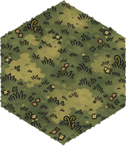

### Mountain_01

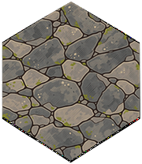

### Dirt_01 — plantilla geométrica provisional

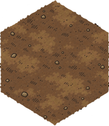

### Ballista

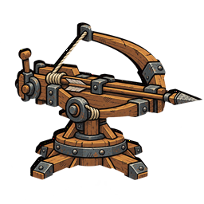

### Rock

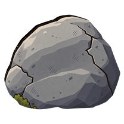

La tabla técnica y la validación están en [el manifiesto](#art-manifest) y [el informe de muestras](#art-sample-validation).

La [composición de los 23 assets](../../art_generation/previews/full_asset_composition.png) y la [galería completa](#art-gallery) muestran el lote resultante.

<a id='art-gallery'></a>
## Galería completa del lote

PNG finales fuera de las rutas runtime. Las tierras Dirt usan la geometría aprobada de Grass_01 como proxy, ya que el proyecto no contiene fuentes Dirt. La composición a escala de juego está en [full_asset_composition.png](../../art_generation/previews/full_asset_composition.png); las comprobaciones técnicas están en [CONTENT_AND_ASSETS.md#art-validation](#art-validation).

### Terreno

#### Grass_01


#### Grass_02
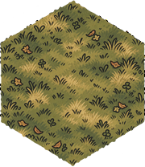

#### Grass_03
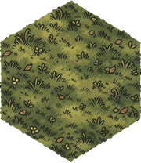

#### Mountain_01


#### Mountain_02
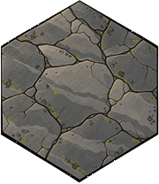

#### Mountain_03
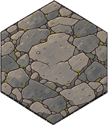

#### Dirt_01 — proxy geométrico de Grass_01


#### Dirt_02 — proxy geométrico de Grass_01
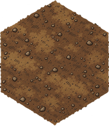

#### Dirt_03 — proxy geométrico de Grass_01
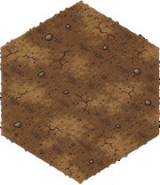

### Obstáculos

#### Cristal
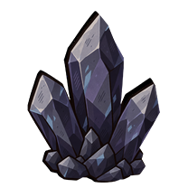

#### Roca


#### Hierba alta
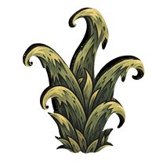

#### Tótem
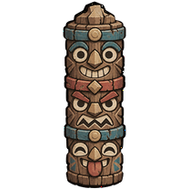

#### Pila de huesos
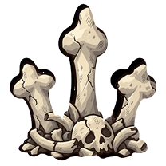

### Estructuras

#### Base
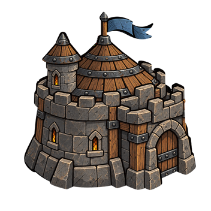

#### Portal de aparición
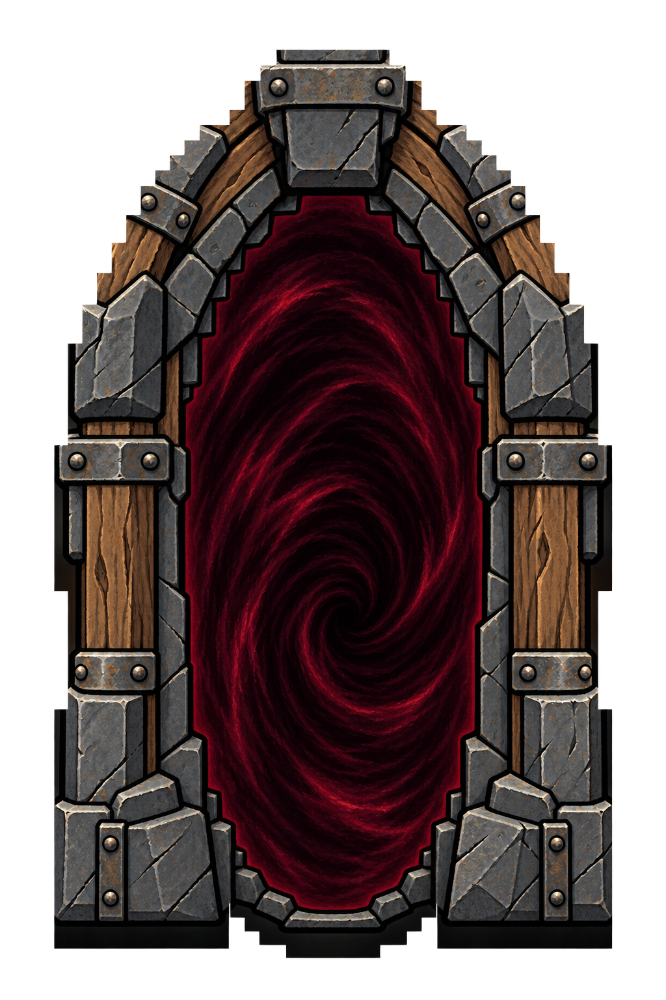

### Torres

#### Ballista


#### Mortar
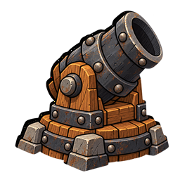

#### Tesla Coil
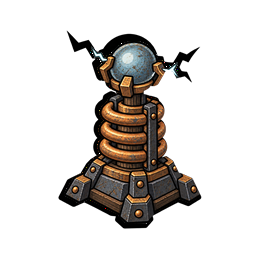

#### Frost Keep
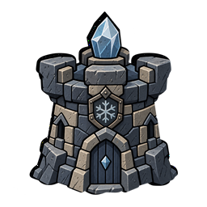

#### Flame Thrower
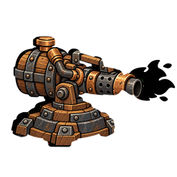

#### Shredder
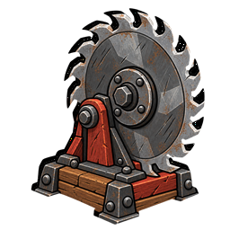

#### Poison Sprayer
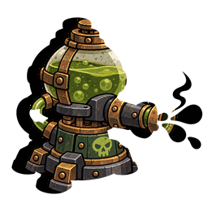

<a id='art-validation'></a>
## Validación técnica del lote

> **Snapshot histórico del 2026-10-13:** las rutas de la tabla son las que existían cuando se validó ese lote; M43 trasladó los sprites activos bajo `assets/sprites/`. La sección de obstáculos registra el pool anterior a M39 y no describe el contenido runtime actual. Consulta [assets/sprites/CONTENT_AND_ASSETS.md#sprite-catalog](#sprite-catalog) para la fuente vigente.

**Fecha:** 2026-10-13\
**Resultado:** 23/23 destinos coinciden con su arte; 23/23 originales respaldados.\
**Método:** canvas y modo RGBA cotejados; píxeles runtime cotejados byte a byte con el arte asignado; canal alfa runtime cotejado byte a byte con el original respaldado.

Las tres variantes Dirt se asignan a los tres destinos PATH por decisión explícita del usuario. Se adaptó el canal alfa de cada salida Dirt a la silueta del Path original. El tipo PATH, los sockets, el grafo y las flechas de flujo no cambiaron.

| Asset | Destino runtime | Arte instalado | Original respaldado | Canvas | Modo | Alfa original | Coincide con arte | Nota | Estado |
|---|---|---|---|---:|---|---|---|---|---|
| PATH_01 ← DIRT_01 | `assets/terrain/tiles/path_01.png` | `art_generation/integration/path_01.png` | `art_generation/originals_replaced/2026-10-13/assets/terrain/tiles/path_01.png` | 180×208 | RGBA | idéntica | idéntico | Dirt aplicado a PATH | OK |
| PATH_02 ← DIRT_02 | `assets/terrain/tiles/path_02.png` | `art_generation/integration/path_02.png` | `art_generation/originals_replaced/2026-10-13/assets/terrain/tiles/path_02.png` | 180×208 | RGBA | idéntica | idéntico | Dirt aplicado a PATH | OK |
| PATH_03 ← DIRT_03 | `assets/terrain/tiles/path_03.png` | `art_generation/integration/path_03.png` | `art_generation/originals_replaced/2026-10-13/assets/terrain/tiles/path_03.png` | 180×208 | RGBA | idéntica | idéntico | Dirt aplicado a PATH | OK |
| GRASS_01 | `assets/terrain/tiles/grass_01.png` | `art_generation/generated/samples/grass_01.png` | `art_generation/originals_replaced/2026-10-13/assets/terrain/tiles/grass_01.png` | 180×208 | RGBA | idéntica | idéntico | — | OK |
| GRASS_02 | `assets/terrain/tiles/grass_02.png` | `art_generation/generated/terrain/grass_02.png` | `art_generation/originals_replaced/2026-10-13/assets/terrain/tiles/grass_02.png` | 180×208 | RGBA | idéntica | idéntico | — | OK |
| GRASS_03 | `assets/terrain/tiles/grass_03.png` | `art_generation/generated/terrain/grass_03.png` | `art_generation/originals_replaced/2026-10-13/assets/terrain/tiles/grass_03.png` | 180×208 | RGBA | idéntica | idéntico | — | OK |
| MOUNTAIN_01 | `assets/terrain/tiles/mountain_01.png` | `art_generation/generated/samples/mountain_01.png` | `art_generation/originals_replaced/2026-10-13/assets/terrain/tiles/mountain_01.png` | 180×208 | RGBA | idéntica | idéntico | — | OK |
| MOUNTAIN_02 | `assets/terrain/tiles/mountain_02.png` | `art_generation/generated/terrain/mountain_02.png` | `art_generation/originals_replaced/2026-10-13/assets/terrain/tiles/mountain_02.png` | 180×208 | RGBA | idéntica | idéntico | — | OK |
| MOUNTAIN_03 | `assets/terrain/tiles/mountain_03.png` | `art_generation/generated/terrain/mountain_03.png` | `art_generation/originals_replaced/2026-10-13/assets/terrain/tiles/mountain_03.png` | 180×208 | RGBA | idéntica | idéntico | — | OK |
| OBSTACLE_CRYSTAL | `assets/terrain/obstacles/crystal_shard.png` | `art_generation/generated/obstacles/crystal.png` | `art_generation/originals_replaced/2026-10-13/assets/terrain/obstacles/crystal_shard.png` | 208×208 | RGBA | idéntica | idéntico | — | OK |
| OBSTACLE_ROCK | `assets/terrain/obstacles/rock.png` | `art_generation/generated/samples/rock.png` | `art_generation/originals_replaced/2026-10-13/assets/terrain/obstacles/rock.png` | 208×208 | RGBA | idéntica | idéntico | — | OK |
| OBSTACLE_GRASS | `assets/terrain/obstacles/tall_grass.png` | `art_generation/generated/obstacles/grass.png` | `art_generation/originals_replaced/2026-10-13/assets/terrain/obstacles/tall_grass.png` | 208×208 | RGBA | idéntica | idéntico | — | OK |
| OBSTACLE_TOTEM | `assets/terrain/obstacles/totem.png` | `art_generation/generated/obstacles/totem.png` | `art_generation/originals_replaced/2026-10-13/assets/terrain/obstacles/totem.png` | 208×208 | RGBA | idéntica | idéntico | — | OK |
| OBSTACLE_BONES | `assets/terrain/obstacles/stone_pile.png` | `art_generation/generated/obstacles/bones.png` | `art_generation/originals_replaced/2026-10-13/assets/terrain/obstacles/stone_pile.png` | 208×208 | RGBA | idéntica | idéntico | — | OK |
| BASE | `assets/base/main_tower.png` | `art_generation/generated/structures/base.png` | `art_generation/originals_replaced/2026-10-13/assets/base/main_tower.png` | 352×352 | RGBA | idéntica | idéntico | — | OK |
| SPAWN_PORTAL | `assets/terrain/spawn_portal.png` | `art_generation/generated/structures/spawn_portal.png` | `art_generation/originals_replaced/2026-10-13/assets/terrain/spawn_portal.png` | 1024×1536 | RGBA | idéntica | idéntico | — | OK |
| TOWER_BALLISTA | `assets/ui/icons/ballista.png` | `art_generation/generated/samples/ballista.png` | `art_generation/originals_replaced/2026-10-13/assets/ui/icons/ballista.png` | 256×256 | RGBA | idéntica | idéntico | — | OK |
| TOWER_MORTAR | `assets/ui/icons/mortar.png` | `art_generation/generated/towers/mortar.png` | `art_generation/originals_replaced/2026-10-13/assets/ui/icons/mortar.png` | 256×256 | RGBA | idéntica | idéntico | — | OK |
| TOWER_TESLA_COIL | `assets/ui/icons/tesla_coil.png` | `art_generation/generated/towers/tesla_coil.png` | `art_generation/originals_replaced/2026-10-13/assets/ui/icons/tesla_coil.png` | 256×256 | RGBA | idéntica | idéntico | — | OK |
| TOWER_FROST_KEEP | `assets/ui/icons/frost_keep.png` | `art_generation/generated/towers/frost_keep.png` | `art_generation/originals_replaced/2026-10-13/assets/ui/icons/frost_keep.png` | 256×256 | RGBA | idéntica | idéntico | — | OK |
| TOWER_FLAMETHROWER | `assets/ui/icons/flame_thrower.png` | `art_generation/generated/towers/flame_thrower.png` | `art_generation/originals_replaced/2026-10-13/assets/ui/icons/flame_thrower.png` | 256×256 | RGBA | idéntica | idéntico | — | OK |
| TOWER_SHREDDER | `assets/ui/icons/shredder.png` | `art_generation/generated/towers/shredder.png` | `art_generation/originals_replaced/2026-10-13/assets/ui/icons/shredder.png` | 256×256 | RGBA | idéntica | idéntico | — | OK |
| TOWER_POISON_SPRAYER | `assets/ui/icons/poison_sprayer.png` | `art_generation/generated/towers/poison_sprayer.png` | `art_generation/originals_replaced/2026-10-13/assets/ui/icons/poison_sprayer.png` | 256×256 | RGBA | idéntica | idéntico | — | OK |

### Revisión visual

La composición estática conjunta permite revisar las superficies, obstáculos, torres, base y portal. No contiene el grafo runtime ni las flechas, que siguen dibujándose desde la lógica existente.

[Abrir la composición conjunta](../../art_generation/previews/full_asset_composition.png). La aceptación artística del conjunto puede revisarse en juego.

Los sprites finales se instalaron en las rutas runtime existentes. Los 23 originales se conservaron en `art_generation/originals_replaced/2026-10-13/`.

<a id='art-sample-validation'></a>
## Validación de muestras

**Estado:** el usuario aprobó las cinco muestras el 2026-10-13 y autorizó producir las 18 restantes.

### Resultado técnico

Las salidas de ImageGen se conservaron como intermediarios de alta resolución en raw/. El exportador [fit_sprite_to_source.py](../../art_generation/tools/fit_sprite_to_source.py) solo las reduce con Lanczos al canvas de la fuente y sustituye el canal alfa por el original; el dibujo visible procede de la generación, no de un filtro de color. En los cinco resultados el tamaño, modo RGBA y bytes del canal alfa coinciden con la fuente estructural. Dirt_01 coincide con la máscara de Grass_01, que se usó como proxy porque no existe fuente Dirt.

| Archivo final | Tamaño | Modo | Máscara alfa | Nota de estructura |
|---|---:|---|---|---|
| generated/samples/grass_01.png | 180×208 | RGBA | Idéntica a Grass_01 | Hex y orientación originales. |
| generated/samples/mountain_01.png | 180×208 | RGBA | Idéntica a Mountain_01 | Placas y distribución top-down; la transparencia define el hex. |
| generated/samples/dirt_01.png | 180×208 | RGBA | Idéntica a Grass_01 proxy | Superficie genérica; sin camino ni huellas. |
| generated/samples/ballista.png | 256×256 | RGBA | Idéntica a la fuente Ballista | Arco, cuerda, virote, base y dirección conservados. |
| generated/samples/rock.png | 208×208 | RGBA | Idéntica a OBSTACLE_ROCK | Masa compacta y apoyo conservados; sin terreno debajo. |

### Revisión visual de las muestras

- **Grass_01:** oliva y musgo apagados, grupos de hierba dibujados con tinta, flores pequeñas y lectura clara a tamaño reducido.
- **Mountain_01:** placas de pizarra, grietas y musgo secundario. Se corrigió el marco continuo que apareció en la primera generación; la última versión deja que las placas lleguen al límite alfa.
- **Dirt_01:** tierra umber con gravilla escasa y rayado corto. No hay elementos que sugieran una ruta. Es una muestra provisional porque no existe una fuente Dirt propia.
- **Ballista:** la silueta mecánica, el eje del virote y la estructura de madera/hierro siguen siendo reconocibles. Se omitieron proyectiles en vuelo y efectos de ataque.
- **Rock:** roca gris angulosa, sombreado pintado mate y silueta compacta. Mantiene el canvas transparente independiente.

El usuario aprobó estas cinco muestras y el uso de Grass_01 como proxy geométrico de Dirt_01. A partir de ese visto bueno se generaron las otras 18 piezas. La aceptación artística del conjunto completo queda pendiente de su revisión; el control técnico y la composición están en el [informe final](#art-validation) y la [vista conjunta](../../art_generation/previews/full_asset_composition.png). No se ha probado la integración runtime porque los archivos siguen aislados y no se cambiaron recursos del juego.

<a id='external-references'></a>
## Índice de referencias externas

Estos documentos reúnen material de *Rogue Tower* y comparaciones preparadas para el proyecto. Su ubicación en esta carpeta deja claro que no son especificaciones propias. Consulta [la fuente de diseño activa](PROJECT_SPEC.md#game-design) y el [backlog de candidatos](BACKLOG.md#candidates) para saber qué se ha promovido.

| Documento | Contenido | Límite de autoridad |
|---|---|---|
| [01 — Torres](#reference-towers) | Roles, parámetros y mecánicas de referencia para siete arquetipos. | Los parámetros base seleccionados están promovidos con ajustes oficiales en ADR-0036 y Resources; los árboles completos no lo están. |
| [02 — Monstruos](#reference-enemies) | Tablas de atributos/oleada inicial y comportamientos, incluidas variantes de Ooogie. | Los perfiles normales hasta wave20 están promovidos en ADR-0035; los encuentros especiales tienen reglas propias. Esta página no incluye cantidades/grupos por oleada. |
| [03 — Upgrades](#reference-upgrades) | Árboles de mejoras permanentes y cards de referencia. | ADR-0062 integra las 173 cartas compatibles y 25 mejoras permanentes adicionales como contenido configurable/provisional. Se excluyen torres y sistemas ausentes; la frecuencia propia de oferta cada tres rondas prevalece sobre cualquier frecuencia de la fuente. |
| [04 — Efectos de estado](#reference-effects) | Estados, reglas y sinergias del juego de referencia. | Bleed/Burn/Poison/Slow tienen contrato propio; Freeze/Haste/Fortification siguen sin aprobar. |
| [Towers — Rogue Tower Wiki](https://rogue-tower.fandom.com/wiki/Towers) | Precio de torres y referencia de requisitos de unlock. | Wiki comunitaria consultada el 2026-10-13; contexto para ADR-0064/0069. La página directa devolvió HTTP 402; la tabla de XP aportada por el usuario fija los costes de esta demo. |
| [Upgrades — Rogue Tower Wiki](https://rogue-tower.fandom.com/wiki/Upgrades) | XP persistente obtenido tras cada partida y gastado en desbloqueos/mejoras. | Wiki comunitaria consultada el 2026-10-13; solo se adopta el principio y los costes pedidos por el usuario, no su fórmula de recompensa. Ver ADR-0069. |
| [Rogue Tower for Newbs (OUTDATED) — Steam Community](https://steamcommunity.com/sharedfiles/filedetails/?id=2742933260) | Guía comunitaria con contexto sobre venta de torres mejoradas. | Marcada como desactualizada; consultada el 2026-10-13, solo contexto para ADR-0064. |
| [ORIGEN](#origin-and-sources) | Procedencia del paquete de diseño y fuentes externas. | Mantener títulos, URLs, versión/edición conocida y fecha de consulta. |

Los resúmenes derivados de wiki conservan atribución y licencia señalada por la fuente. No se reutilizan assets. Una discrepancia de una fuente comunitaria no se convierte en regla propia; se registra como candidata o se deja como referencia. La escritura vigente de nombres y el límite de cada equivalencia están en [Nomenclatura](#canonical-names).

<a id='origin-and-sources'></a>
## Origen y referencias

### Fuente de diseño del proyecto

- Título: *Tower Defense Roguelike — Codex Handoff*.
- Archivo recibido: `tower_defense_roguelike_codex_pack.zip`.
- Ubicación al recibirlo: `D:/DescargaRuben/tower_defense_roguelike_codex_pack.zip`.
- Autor, edición y licencia: no indicados en el paquete.
- Fecha de recepción y consulta: 2026-10-07.
- Contenido importado: los 12 documentos numerados, el prompt inicial y `project_spec.json`.
- Estado: especificación inicial suministrada por el usuario. El diseño activo incorpora decisiones posteriores y su jerarquía está definida en [el índice](README.md#index); las instrucciones operativas del paquete se aplican solo si no contradicen instrucciones de mayor prioridad ni peticiones posteriores del usuario.

### Referencias externas

Estas fuentes orientan el contexto. No sustituyen las reglas propias confirmadas en `PROJECT_SPEC.md`.

| Título | URL | Edición o versión | Consulta | Uso y límites |
|---|---|---|---|---|
| *Rogue Tower* — página oficial de Steam | <https://store.steampowered.com/app/1843760/Rogue_Tower/> | Versión de tienda consultada; la página no fija una versión de juego | 2026-10-07 | Contexto oficial del juego de referencia. Para mecánicas sensibles al parche, revisar también anuncios y notas oficiales. |
| Anuncios oficiales de *Rogue Tower* en Steam | <https://steamcommunity.com/app/1843760/announcements/> | Anuncios y parches publicados por el desarrollador | 2026-10-07 | Fuente primaria para comprobar cambios de mecánicas y discrepancias con wikis comunitarias. |
| *Rogue Tower Wiki* | <https://rogue-tower.fandom.com/wiki/Rogue_Tower_Wiki> | Wiki comunitaria; edición cambiante | 2026-10-07 | Índice y contexto, no balance vigente por sí solo. No se usó para definir este milestone. |
| *Shredder* — Rogue Tower Wiki | <https://rogue-tower.fandom.com/wiki/Shredder> | Wiki comunitaria; versión/edición no visible | 2026-10-08 | Referencia de rol para la hoja que avanza por PATH, perfora enemigos, pierde daño por impacto y aplica Bleed. Se adaptó el arquetipo; no se copió el balance. |
| *Rogue Tower Wiki* — Towers, Monsters, Status Effects, Upgrade Cards y Permanent Upgrades | <https://rogue-tower.fandom.com/wiki/Towers>, <https://rogue-tower.fandom.com/wiki/Monsters>, <https://rogue-tower.fandom.com/wiki/Status_Effects>, <https://rogue-tower.fandom.com/wiki/Upgrade_Cards>, <https://rogue-tower.fandom.com/wiki/Permanent_Upgrades> | Wiki comunitaria; versión/edición no visible | 2026-10-09 | Nombres canónicos, parámetros publicados de torres y perfiles base de enemigos aprobados en ADR-0035, más referencia para cards/estados. La página Monsters no da conteos/grupos de enemigos por wave; no se atribuyen esos valores a la fuente. Los jefes/minibosses con balance propio siguen las decisiones del proyecto. |
| *Rogue Tower Wiki* — Upgrade Cards y Permanent Upgrades | <https://rogue-tower.fandom.com/wiki/Upgrade_Cards>, <https://rogue-tower.fandom.com/wiki/Permanent_Upgrades> | Wiki comunitaria; edición cambiante, sin versión visible | 2026-10-13 | Base del catálogo compatible integrado en ADR-0062: 173 cartas de las siete torres activas y generales, más 25 mejoras permanentes. La petición web directa devolvió bloqueo de Fandom; se cotejaron los extractos indexados disponibles. No se importan tarjetas que requieren torres/sistemas ausentes ni sus mecánicas; los números y costes son valores propios provisionales. |
| *Rogue Tower Wiki* — Map features, Towers, Permanent Upgrades y Upgrade Cards | <https://rogue-tower.fandom.com/wiki/Map_features>, <https://rogue-tower.fandom.com/wiki/Towers>, <https://rogue-tower.fandom.com/wiki/Permanent_Upgrades>, <https://rogue-tower.fandom.com/wiki/Upgrade_Cards> | Wiki comunitaria; edición cambiante, sin versión visible; extractos indexados | 2026-10-14 | Contexto para bonus de elevación (+1 daño y +0,5 rango por nivel) y reglas de fortification. La consulta directa de Permanent Upgrades devolvió HTTP 402. El proyecto adopta tope lógico 0–3 conforme a ADR-0073. No se importan alturas avanzadas 4–6 ni gates de cartas desbloqueadas. |
| *Rogue Tower* — anuncios y changelogs oficiales de Steam | <https://steamcommunity.com/app/1843760/announcements/> | Parche 1.1.2.0 (2022-09-08); último parche oficial localizado 1.3.2.0 (2023-04-07); anuncio de desarrollo de RT2 (2025-06-24) | 2026-10-09 | Fuente primaria de correcciones de balance cuando las fichas comunitarias quedaron obsoletas: Tesla Coil rango 2/Shield 10, Flame Thrower daño 6 y Frost Keep daño 6. Se adoptan Tesla/Flame en ADR-0036; las demás cifras no indicadas por notas permanecen contrastadas con las fichas de torre. |
| *Urtuk: The Desolation* — página de Steam | <https://store.steampowered.com/app/1181830/Urtuk_The_Desolation/> | Edición comercial; publicada el 2021-02-27 | 2026-10-07 | Referencia visual/técnica secundaria para el tablero hexagonal y arte 2D. No se reutiliza arte. |
| *Urtuk: The Desolation* — Press Kit | <https://www.urtuk.com/page/presskit> | Capturas del press kit; versión de cada captura según la página | 2026-10-07 | Referencia visual de campos de batalla hexagonales. No se reutilizan imágenes ni assets. |
| *Tiny Swords* — Pixel Frog, Free Pack | <https://pixelfrog-assets.itch.io/tiny-swords> | Free Pack consultado; la página enumera animaciones de Particle FX y cuatro cursores | 2026-10-09 | Assets de Particle FX y cursores entregados por el usuario. La licencia permite uso personal y comercial, pero prohíbe redistribuir o reempaquetar los archivos fuente; por eso los PNG del pack son una dependencia local ignorada por Git. El resto de la ilustración del terreno y obstáculos se generó para este proyecto. |
| *Godot Engine* — Static typing in GDScript | <https://docs.godotengine.org/en/4.7/tutorials/scripting/gdscript/static_typing.html> | Documentación oficial de Godot 4.7 | 2026-10-07 | Tipado de clases, colecciones, enums y tipos de retorno usados por M1. |
| *Godot Engine* — CanvasItem | <https://docs.godotengine.org/en/4.7/classes/class_canvasitem.html> | Documentación oficial de Godot 4.7 | 2026-10-07 | Referencia de las primitivas 2D usadas por la vista debug de M1. |
| *Godot Engine* — CanvasItem (Y-sort y dibujo 2D) | <https://docs.godotengine.org/en/stable/classes/class_canvasitem.html> | Documentación oficial estable; se consultó la referencia 4.5 | 2026-10-09 | Profundidad 2D: los elementos con mayor Y se dibujan delante; la comparación requiere el mismo Z. Base, torres, enemigos y props se alojan en el mismo contenedor ordenado. |
| *Godot Engine* — Using TileMaps | <https://docs.godotengine.org/en/stable/tutorials/2d/using_tilemaps.html> | Documentación oficial estable | 2026-10-09 | Referencia de `Y Sort Origin` y separación de capas de suelo/frente. Se adapta al renderer axial custom; el proyecto no migra a TileMapLayer. |
| *Godot Engine* — CanvasItem shaders | <https://docs.godotengine.org/en/stable/tutorials/shaders/shader_reference/canvas_item_shader.html> | Documentación oficial estable | 2026-10-09 | Se consultó la animación 2D con `TIME` al comparar shader continuo con cheurones dibujados por segmentos desde `PathGraph`. |
| *Wind Waker 2D Water Shader (Godot 4)* — Godot Shaders | <https://godotshaders.com/shader/wind-waker-2d-water-shader-godot-4/> | Shader comunitario para Godot 4; el snippet declara licencia CC0 | 2026-10-15 | Shader de agua CC0 suministrado por el usuario y adaptado al fondo de pantalla: paleta azul/espuma casi blanca, manchas grandes y movimiento lento. No añade assets externos. |
| *Improved Sprite Pixel Explosion Shader* — Godot Shaders | <https://godotshaders.com/shader/improved-sprite-pixel-explosion-shader/> | Mopifish / m o r b o; shader para Godot 4.7.1, código CC0 | 2026-10-15 | Shader de partículas solicitado para descomponer el sprite del enemigo al morir; se conserva el muestreo por frame y se añaden soporte para espejo horizontal y modulación de sprite. |
| *Moving Arrow on Tiles/Cells for Voxel Engines/Games* — Godot Shaders | <https://godotshaders.com/shader/moving-arrow-on-tiles-cells-for-voxel-engines-games/> | Sentry456123; publicado el 2026-09-18 | 2026-10-09 | Referencia visual solicitada para flechas móviles. Su shader espacial parte de UV por celda de voxel; el juego mantiene flechas 2D por arista del `PathGraph` para conservar ramas y tramos compartidos. |
| *Canvas Group Outline* — Godot Shaders | <https://godotshaders.com/shader/canvas-group-outline/> | liggiorgio; publicado el 2024-07-25 | 2026-10-14 | Referencia del usuario para un borde blanco legible alrededor de objetos. El juego usa dilatación alfa en un `CanvasItem` individual para conservar el Y-sort por sprite; el código del shader no se reutiliza. |
| *Godot Engine* — ThemeDB | <https://docs.godotengine.org/en/4.7/classes/class_themedb.html> | Documentación oficial de Godot 4.7 | 2026-10-07 | Fuente de la tipografía fallback usada para las etiquetas debug. |

Las páginas de Godot Shaders se usan como referencias para flechas, outline, agua y explosión pixel; los dos snippets de shader usados en estos efectos declaran CC0. El agua conserva su patrón de manchas/distorsión con escala y velocidad adaptadas; la explosión incorpora espejo y modulación para coincidir con el sprite real del enemigo. El sprite de portal `assets/sprites/terrain/spawn_portal.png` fue generado para este proyecto con fondo transparente y se conserva como PNG intercambiable. La consulta de *Rogue Tower* en este hito fue solo de contexto; no se implementaron ni balancearon sus mecánicas. La orientación pointy-top de M1 es una decisión de prototipo del proyecto, no una regla atribuida a *Urtuk*.

### Reglas anteriores retiradas

Al reiniciar el proyecto se retiraron los documentos y prototipos que describían chunks 3×3/3×3×3, proyección isométrica fija 2:1 y `TileMapLayer` como modelo del terreno, incluidos los ADR anteriores de topología, presentación y losetas. Esas reglas quedan sustituidas por el paquete de diseño del usuario. Las decisiones compatibles no se presumen vigentes si no aparecen en los documentos nuevos.

<a id='reference-towers'></a>
## Referencia externa: torres

> **Estado:** resumen de referencia externa. El usuario promovió los parámetros base publicados para las siete torres, con los cambios del parche oficial anotados en [ADR-0036](DECISION_HISTORY.md#adr-0036). Sus roles generales también informan el diseño; los árboles completos, reglas no seleccionadas y economía propia siguen en esta referencia. Para números ejecutables consulta el [catálogo activo](#content-roster) y los Resources.

### Roster de referencia y encaje con la demo

| Referencia | Función resumida | Perfil actual más cercano |
|---|---|---|
| Ballista | Proyectil a un objetivo; económica, floja contra Armor y Shield. | Ballista — objetivo único. |
| Mortar | Proyectil explosivo de largo alcance; lento, fuerte contra Armor. | Mortar — área/anti-Armor. |
| Tesla Coil | Descargas a varios enemigos cercanos; fuerte contra Shield. | Tesla Coil — cadena. |
| Frost Keep | Ventisca de área; ralentiza en proporción al 50% de su daño y consume Mana. | Frost Keep — área corta y Slow. |
| Flame Thrower | Ataque de fuego que aplica daño periódico; consume Mana. | Flame Thrower — cono y Burn. |
| Poison Sprayer | Ataque de veneno periódico; consume Mana. | Poison Sprayer — cono y Poison. |
| Shredder | Lanza hojas que recorren el camino y aplican Bleed. | Shredder — hoja que recorre Path. |

La demo confirma siete perfiles con estos nombres y patrones generales. Se promueven los parámetros base de las torres, corregidos con la fuente oficial cuando la wiki conserva un valor obsoleto. Los árboles completos no se copian; las cartas aprobadas de la demo y sus excepciones están en [Nomenclatura](#canonical-names) y el catálogo activo.

### Reglas generales extraídas de la referencia

- Cada torre tiene daño base y multiplicadores distintos para la capa de vida actual. En Rogue Tower se resuelven las capas en orden **escudo → armadura → salud**. Para el juego propio, el usuario confirma ese orden y la fórmula **daño base × multiplicador de la capa activa**.
- Al subir de nivel, la referencia suma +1 al daño base y +1 a uno de los multiplicadores. La torre gana experiencia por el tiempo que mantiene objetivos, según la capa que esté atacando, o puede comprar niveles con oro; el coste de compra crece con el nivel. El extracto no trae la fórmula de XP por segundo.
- En la referencia, cada nivel de elevación añade +1 al daño base y +0,5 al alcance. No se trasladan esos incrementos: el proyecto ya tiene reglas provisionales propias para altura en [ADR-0009](DECISION_HISTORY.md#adr-0009).
- Algunas torres consumen maná por ataque, normalmente ligado al daño base; Frost Keep usa 2 maná/s constante. La elevación también puede aumentar el coste de maná. La cadencia suele ser fija; Frost Keep y Encampment son excepciones en la referencia cuando cubren más caminos.
- Las torres empiezan con 0% de crítico y algunas cartas lo aumentan. También pueden aplicar una parte de su daño como estado si se escogen las cartas correspondientes.
- Las prioridades de objetivo incluyen progreso, vida restante/máxima por capa, velocidad y marcado. La referencia permite hasta tres criterios; la demo implementa por ahora cuatro modos más limitados.
- El coste de construir se encarece por cada torre del mismo tipo presente; demoler reduce ese coste. El nivel de las torres no interviene en el precio de compra/demolición. La economía y los costes de la demo están configurados por separado.
- La probabilidad crítica de referencia escala por tramos: hasta 50% para daño ×2, el siguiente 50% para ×3 y el siguiente 50% para ×4; por encima de 150% no aporta más.

### Cifras y mecánicas fuera del perfil promovido

Algunos valores de tablas comunitarias parecen desalineados o desactualizados. Los parámetros base vigentes son los Resources enlazados desde el catálogo; las diferencias verificadas con notas oficiales se documentan en ADR-0036. Las reglas propias de nivel, altura, mejora manual, economía y estados no se deducen automáticamente del juego de referencia. Los árboles comunitarios completos permanecen aquí como contexto, no como contenido aprobado de la demo.

**Estado vigente del proyecto:** el modelo de cada enemigo contiene pools de Salud, Armadura y Escudo; cada perfil configura sus máximos y cero desactiva una capa para esa unidad. El daño directo afecta a una sola capa activa en orden Escudo→Armadura→Salud. Las torres tienen multiplicadores para las tres capas. Bleed/Burn/Poison bloquean la regeneración de su capa y suman +1 al multiplicador de ataques directos contra esa capa; los ticks hacen daño completo en la capa asociada y mitad en las otras. La implementación actual descarta el exceso al agotar la capa activa; la referencia no documenta expresamente el overkill, por lo que esta política sigue provisional. Ver [ADR-0023](DECISION_HISTORY.md#adr-0023).

### Fuentes

- Texto aportado por el usuario: extracción de las fichas y cartas de torres de Rogue Tower.
- [Towers — Rogue Tower Wiki](https://rogue-tower.fandom.com/wiki/Towers), comunidad Fandom, consulta: 2026-10-09.
- [Ballista](https://rogue-tower.fandom.com/wiki/Ballista), [Mortar](https://rogue-tower.fandom.com/wiki/Mortar), [Tesla Coil](https://rogue-tower.fandom.com/wiki/Tesla_Coil), [Frost Keep](https://rogue-tower.fandom.com/wiki/Frost_Keep), [Flame Thrower](https://rogue-tower.fandom.com/wiki/Flame_Thrower), [Poison Sprayer](https://rogue-tower.fandom.com/wiki/Poison_Sprayer) y [Shredder](https://rogue-tower.fandom.com/wiki/Shredder), Rogue Tower Wiki, consulta: 2026-10-09.
- El contenido comunitario de Rogue Tower Wiki se identifica como CC BY-SA salvo indicación distinta. Este texto es un resumen propio; mantener atribución al reutilizarlo.

<a id='reference-enemies'></a>
## Referencia externa: monstruos

> **Estado:** referencia comunitaria e histórica. Sus tablas describen el snapshot consultado, no el contenido ejecutable propio. La composición de campaña vigente está en [la tabla exacta de 45 rondas](#campaign); los perfiles, nombres y habilidades promovidos están en [el catálogo activo](#content-roster). Wiki Fandom consultada el 2026-10-09; edición/changelog de la página no indicados.

> **Nota de autoridad:** la antigua campaña de veinte rondas, los Minibosses propios de 17/19 y las cantidades inferidas de esta ficha quedaron sustituidos por ADR-0037. La tabla de usuario manda sobre número y orden; la wiki sirve para los perfiles individuales seleccionados.
### Reglas propias confirmadas en el diseño activo

- El modelo de cada enemigo implementa Health, Armor y Shield, agotados en orden Shield → Armor → Health; los perfiles configurables determinan máximos y regeneración.
- Bleed detiene la regeneración de Health y añade +1 al multiplicador de ataques directos contra esa capa; Burn lo hace para Armor y Poison para Shield. Los ticks aplican daño completo en su capa y la mitad en las otras.
- La demo usa los 26 perfiles y 1.093 enemigos directos de la tabla adjunta; ver CONTENT_AND_ASSETS.md#campaign. Esta elección sustituye el alcance anterior de veinte rondas.
- Ooogie von Ooogovich (Haunted) conserva identidad propia, invoca dos Bats cada 2 s y se transforma en Bat con balance propio provisional. La ronda espera su derrota final.
- La composición seleccionada no designa Minibosses especiales en las rondas 17 ni 19. Cyclops y Werewolf son enemigos normales cuando aparecen en la tabla.
- Haste y Fortification se aplican por habilidades enemigas: fuerza máxima 60, decaimiento 6/s, radio de aura 2 hexágonos y trigger cerca de la base a 5 hexágonos. Sus reglas y triggers por perfil están en CONTENT_AND_ASSETS.md#content-roster.

### Reglas generales de la referencia

- Un monstruo puede tener Health, Armor y Shield; se agotan en ese orden. Bleed contrarresta regeneración de Health, Burn la de Armor y Poison la de Shield.
- La velocidad de las tablas es el valor publicado por la wiki, no una unidad compatible directamente con la velocidad del juego.
- Los monstruos normales hacen 1 de daño a la base; los jefes pueden destruirla de un golpe.
- El oro suele equivaler a la ronda en que empieza a aparecer; Goblin da 4. Los jefes dan más, y cada tipo de torre que haya dañado al enemigo añade 1 oro.
- La wiki también cita mejoras permanentes y cartas Banditry/Gold Rush! como fuentes de oro extra.
- La información de reglas/modos de Rogue Tower que sigue es contexto de referencia y no define las reglas del juego propio.
- En la referencia, tras la ronda 15 cada ronda impar genera un mini-jefe con el doble de vida de un monstruo normal, daño alto a la base y posibilidad de dejar cofre. El usuario confirma apariciones en las rondas 17 y 19; el resto de esas mecánicas sigue siendo solo referencia.
- La wiki indica cofres de jefe con 1–3 extracciones en Single, 1–4 en Double y 1–5 en Triple Defense; cada extracción ofrece la mitad de cartas normales, redondeada hacia arriba. Solo Single Defense coincide con el alcance del proyecto.
- Solo aparece una familia de Tier 2 por partida: Haunted, Undead o Ephemerald.

### Tier 1 — rondas 1–15

Valores de la tabla que aportó el usuario. `H/A/S` = Health/Armor/Shield; `+n/s` indica regeneración.

| Monstruo | Desde | Vel. | H / A / S | Gold |
|---|---:|---:|---:|---:|
| [Goblin](https://rogue-tower.fandom.com/wiki/Goblin) | 1 | 2 | 100 / 0 / 0 | 4 |
| Orc | 3 | 2 | 300 / 0 / 0 | 3 |
| [Armored Goblin](https://rogue-tower.fandom.com/wiki/Armored_Goblin) | 5 | 1,75 | 400 / 200 / 0 | 5 |
| [Troll](https://rogue-tower.fandom.com/wiki/Troll) | 7 | 1,75 | 800 (+25/s) / 0 / 0 | 7 |
| Armored Orc | 9 | 1,75 | 400 / 600 / 0 | 9 |
| Battering Ram | 11 | 1 | 300 / 1500 / 0 | 11 |
| [Cyclops](https://rogue-tower.fandom.com/wiki/Cyclops) | 13 | 1,25 | 2000 / 0 / 0 | 13 |
| [Ooogie](https://rogue-tower.fandom.com/wiki/Ooogie), jefe | 15 | 1 | 20000 / 0 / 0 | 315 |

**Comportamientos distintivos consultados:** Armored Goblin concede 30 de Fortification a sí mismo y a monstruos cercanos al aparecer; Troll regenera 25 de salud/s; Cyclops concede 20 de Fortification a enemigos cercanos al morir; Ooogie obtiene 60 de Haste al aparecer y 60 de Fortification al quedar a 20 bloques de la base. Goblin se describe como enemigo básico sin ataque especial.

### Tier 2 — referencia completa hasta la familia que comienza en la ronda 25

La wiki sitúa Tier 2 entre las rondas 16–25. `—` = 0 en la tabla aportada. Este párrafo conserva el estado de promoción anterior a ADR-0037: entonces se había limitado la familia Haunted a la ronda 20 y se había propuesto una colocación fija para `Ooogie von Ooogovich`. Ambas limitaciones quedaron sustituidas; consulta el [roster activo](#content-roster) y la [tabla exacta](#campaign).

#### Haunted

| Monstruo | Desde | Vel. | H / A / E |
|---|---:|---:|---:|
| [Witch](https://rogue-tower.fandom.com/wiki/Witch) | 16 | 3 | 1000 / — / 1000 |
| Bat | 18 | 3,6 | 2000 / — / — |
| [Vampire](https://rogue-tower.fandom.com/wiki/Vampire) | 20 | 2 | 3000 (+100/s) / — / 1000 |
| [Jack'o'Lantern](https://rogue-tower.fandom.com/wiki/Jack%27o%27Lantern) | 22 | 1,5 | 1000 / 5000 / — |
| [Werewolf](https://rogue-tower.fandom.com/wiki/Werewolf) | 24 | 2 | 3000 (+100/s) / — / 2000 |
| [Ooogie von Ooogovich](https://rogue-tower.fandom.com/wiki/Ooogie_von_Ooogovich), jefe | 25 | 1,1 | 40000 (+100/s) / — / — |

**Comportamientos:** Witch se acelera cerca de la base; Vampire regenera y al morir se convierte en Bat; Jack'o'Lantern aparece con Haste y, al perder su armadura, acelera a enemigos cercanos; Werewolf regenera, aparece con Haste y obtiene Fortification cerca de la base. Ooogie von Ooogovich invoca dos Bats cada 2 s y, al morir, se convierte en un Bat de 10000 de salud.

#### Undead

| Monstruo | Desde | Vel. | H / A / E |
|---|---:|---:|---:|
| [Zombie](https://rogue-tower.fandom.com/wiki/Zombie) | 16 | 1 | 2000 / — / 4000 |
| Skeleton | 18 | 1,5 | 1000 / 4000 / — |
| [Lich](https://rogue-tower.fandom.com/wiki/Lich) | 20 | 1,75 | 4000 / — / 1000 |
| [Ghoul](https://rogue-tower.fandom.com/wiki/Ghoul) | 22 | 2,25 | 1000 / 3000 / — |
| Mummy | 24 | 1,25 | 1000 / 6000 (+100/s) / 1000 |
| [God King Ooogie](https://rogue-tower.fandom.com/wiki/God_King_Ooogie), jefe | 25 | 1,1 | 10000 (+100/s) / 60000 (+100/s) / — |

**Comportamientos:** Zombie aparece con Fortification; Lich cada 3 s elimina Bleed y cura 400 de salud a aliados cercanos; Ghoul aparece con Haste y al perder armadura gana Haste y Fortification; Mummy regenera armadura. God King Ooogie aparece con Haste y al perder armadura invoca cuatro Mummies.

#### Ephemerald

| Monstruo | Desde | Vel. | H / A / E |
|---|---:|---:|---:|
| [Spirit](https://rogue-tower.fandom.com/wiki/Spirit) | 16 | 2 | 1000 / — / 2000 |
| Shadow | 18 | 1,75 | 1000 / — / 3000 |
| [Orb](https://rogue-tower.fandom.com/wiki/Orb) | 20 | 1 | 2000 / — / 6000 |
| [Ghost](https://rogue-tower.fandom.com/wiki/Ghost) | 22 | 2,25 | 4000 / — / — |
| [Phantom Warrior](https://rogue-tower.fandom.com/wiki/Phantom_Warrior) | 24 | 2 | 1000 / 1000 / 3000 |
| [Soul Shepherd Ooogie](https://rogue-tower.fandom.com/wiki/Soul_Shepherd_Ooogie), jefe | 25 | 1,1 | 10000 (+100/s) / — / 40000 (+100/s) |

**Comportamientos:** Spirit obtiene Haste al perder escudo; Orb se teletransporta 15 casillas al perderlo; Ghost no tiene ataque especial en su ficha; Phantom Warrior al perder escudo otorga Haste y Fortification a sí mismo y a enemigos cercanos. Soul Shepherd Ooogie aparece con Haste y, al perder escudo, invoca cuatro Ghosts y acelera a los cercanos.

### Límites y discrepancias de la referencia

- La página general Monsters publica apariciones iniciales, parámetros base y lista de unidades, pero no cantidades/grupos exactos por oleada. La composición propia procede exclusivamente de la tabla adjunta seleccionada por el usuario.
- Vampire tiene valores diferentes entre la tabla general y su ficha individual. El Resource propio adopta la ficha individual de 5.000 Health sin Shield; la decisión está registrada en ADR-0037.
- Las habilidades individuales de jefes y de los polígonos pueden incluir estados, invocaciones, fases y overrides. El catálogo activo detalla qué mecánicas se implementan y qué balance es propio.
- El daño sobrante al vaciar una capa no tiene regla confirmada por el artículo; el proyecto lo descarta provisionalmente según ADR-0023.
- Esta referencia no reemplaza la nomenclatura visible de CONTENT_AND_ASSETS.md#canonical-names ni la composición de CONTENT_AND_ASSETS.md#campaign.
### Fuentes

- [Monsters — Rogue Tower Wiki](https://rogue-tower.fandom.com/wiki/Monsters) y fichas individuales enlazadas en las tablas; comunidad Fandom, consulta: 2026-10-09.
- Los datos base se transcriben del extracto proporcionado por el usuario; las notas de comportamiento son resúmenes de fichas individuales consultables. Contenido comunitario CC BY-SA salvo indicación distinta; conservar atribución al reutilizarlo.

<a id='reference-upgrades'></a>
## Referencia externa: mejoras

> **Estado:** resumen histórico de mejoras de referencia, no balance ni progresión aprobada. Las mejoras permanentes y las cartas durante una run son sistemas distintos. El proyecto actual implementa una demo de 45 rondas y una meta-progresión propia; véase [la fuente de verdad](PROJECT_SPEC.md#game-design). Las cifras de abajo provienen del material aportado por el usuario y no constituyen un calendario activo.

### Mejoras permanentes entre partidas

La referencia indica que ganar la partida concede **450 XP extra**. Los XP y umbrales siguientes pertenecen a Rogue Tower, no a la economía/meta moneda actual del proyecto.

El extracto deja vacío el XP base recibido al terminar la partida; solo especifica el extra por ganar. Las parejas de requisitos abreviadas como `cartas/XP` indican cartas desbloqueadas y experiencia necesaria.

| Rama | Progresión resumida | Requisitos aportados |
|---|---|---|
| **Card Draw I–III** | +1 carta por selección de mejora en cada nivel; total de 4, 5 y 6 opciones. | I: 25 XP. II: 20 cartas desbloqueadas contando I y 50 XP. III: 30 cartas contando II y 75 XP. |
| **Treasure!** | +1 carta por cofre de tesoro. | 45 cartas desbloqueadas contando Card Draw III y 100 XP. |
| **Draw Frequency I–II** | Ofrece cartas cada 2 rondas; luego cada ronda. | I: 30 cartas y 50 XP. II: 60 cartas contando I y 100 XP. |
| **Gold Drop I–V** | +1 oro por enemigo y nivel; máximo +5. | I: 15 XP. II–V: 5/30, 10/60, 20/120 y 49/240 cartas/XP, incluyendo el nivel anterior. |
| **Treasury I–X** | +100 oro inicial por nivel; máximo +1000. | I: 20 XP. II–X: 10/40 XP, 20/60, 30/80, 40/100, 50/120, 60/140, 70/160, 80/180 y 90/200. Cada pareja es cartas desbloqueadas/XP y requiere el nivel anterior. |
| **Sourcery I–III** | +1 maná/s por nivel; máximo +3/s. | I: 10 XP. II: 5 cartas y 25 XP. III: 10 cartas y 50 XP. |
| **Mana Capacity I–V** | +20 de capacidad máxima por nivel; máximo +100. | I: 25 XP. II–V: 5/50, 10/75, 20/100 y 30/125 cartas/XP; requiere el nivel anterior. |

### Cartas de torres durante la run

La mayoría de ramas repiten una estructura: tres mejoras por capa de vida que suman **+6** (incrementos de +1, +2 y +3), una mejora crítica de **+15%**, y una carta **Monster Studies** que da +1 al daño de esa capa para todas las torres. Las mejoras permanentes propias de cada torre dan +1 a una capa por 120 XP.

Las cartas específicas suelen requerir escoger la torre y avanzar por la carta previa de la rama; el extracto muestra costes por carta variables y a veces vacíos, así que aquí se resume el árbol y no se normaliza ese coste individual.

| Torre de referencia | Resumen de ramas y cartas características |
|---|---|
| **Ballista** | Broadhead Bolts (salud); Jagged Heads (Bleed); Frost Bolts (Slow) y Freezing Bolts (3% de congelar); Heavy Shafts (armadura), Flamming Bolts (Burn) y Longbow (multiplica la bonificación de alcance por elevación); Enchanted Bolts (escudo), Poison Bolts y Mana Bolts (+4 de daño por nivel, a cambio de 10/20/25% del daño base en maná por disparo). Better Bolts: +1 permanente por capa. |
| **Mortar** | HE Shells (salud), Fragmentation (Bleed) y Long Range Ballistics (+5 de alcance por nivel); Concussive Shells (armadura), Incendiary Rounds (Burn) y Area of Effect (+50% de radio por nivel, hasta +150%); EMP (escudo), Gas Shells (Poison) y Mana Bombs (+4 de daño por nivel y coste de maná creciente). Better Bombs: +1 permanente por capa. |
| **Tesla Coil** | Power Surge (salud) + Bleed; Plasmatics (armadura) + Burn; Static Permeation (escudo) + Poison. Cada rama suma daño por capa; Advanced Circuits da +15% crítico. Better Electricity: +1 permanente por capa. |
| **Frost Keep** | Frostbite/Dehydration/Conductive Snow aumentan daño por capa; Vampiric Snow añade Bleed, Flammable Snow Burn, Yellow Snow Poison. Deep Freeze suma 5% de congelación de 1 s por nivel (hasta 15%); Ice Breaker añade +1 de daño contra congelados por nivel (hasta +3); Blizzard da +1 alcance por nivel; Absolute Zero sube el límite de Slow en +10. Better Snow: +1 permanente por capa. |
| **Flame Thrower** | Napalm/Nitric Acid/White Phosphorus aumentan daño por capa. Fuel Saturation añade +50% Burn por nivel (hasta +200%); Everything Burns aumenta el límite de Burn/s en 100. Better Fire: +1 permanente por capa. |
| **Poison Sprayer** | Infection/Corrosion/Fumigation aumentan daño por capa. Spores añade +50% Poison por nivel (hasta +200%); Pandemic aumenta el límite de Poison/s en 100. Better Poison: +1 permanente por capa. |
| **Shredder** | Sharpened/Hardened/Magnetic Blades aumentan daño por capa. Thrashing añade +50% Bleed por nivel (hasta +200%); Everything Bleeds aumenta el límite de Bleed/s en 100. Better Sawblades: +1 permanente por capa. |

Las cartas de estado de la referencia pueden aumentar daño del equipo contra enemigos afectados y elevar límites de DoT; los detalles están en [Status Effects](#reference-effects). El proyecto implementa el bonus de +1 al multiplicador de Health/Armor/Shield para ataques contra enemigos con Bleed/Burn/Poison, además de los ticks y counters de regeneración. Ese multiplicador propio difiere del daño plano de las cartas Monster Studies de Rogue Tower. El pool M11 contiene solo un subconjunto configurable de las ramas de referencia; los nombres que sí se adoptaron están listados en [Nomenclatura](#canonical-names).

### Encaje con Rogue Tower

- El proyecto tiene un multiplicador Shield y una barra visual para esa capa. Cuando un perfil tiene Shield máximo mayor que cero, la barra azul se dibuja sobre Armor y Health; el dummy DEBUG y el perfil actual de Ooogie von Ooogovich permiten comprobarlo.
- La wiki también nombra Banditry y Gold Rush! como cartas de run que aumentan el oro; el extracto recibido no aporta sus valores ni condiciones.
- Las cards de la demo y sus correspondencias de nombre están decididas en Resources y ADR-0033; esta lista sigue siendo una descripción de la referencia.
- Las torres, sus cards, la economía y XP de la referencia son contenido comunitario. No importar cifras o progresión como balance vigente sin decisión de diseño.

### Fuentes

- Extractos aportados por el usuario: Single Defense, permanent upgrades y pools simplificados de cartas de las siete torres.
- [Permanent Upgrades](https://rogue-tower.fandom.com/wiki/Permanent_Upgrades), [Upgrade Cards](https://rogue-tower.fandom.com/wiki/Upgrade_Cards) y fichas de torres enlazadas en [01_torres.md](#reference-towers), Rogue Tower Wiki, consulta: 2026-10-08.
- Rogue Tower Wiki es contenido comunitario CC BY-SA salvo indicación distinta; este texto lo resume y debe conservar atribución si se reutiliza.

<a id='reference-effects'></a>
## Referencia externa: estados

> **Estado:** resumen de reglas de Rogue Tower para comparar; no confirmado como balance. El contrato vigente del proyecto está en [ADR-0023](DECISION_HISTORY.md#adr-0023); ADR-0012 conserva el estado histórico al cierre de M8.

### Regla propia confirmada por el usuario

Bleed detiene la regeneración de Health, Burn la de Armor y Poison la de Shield. En el proyecto, además, el estado activo suma +1 una sola vez al multiplicador de los ataques directos de su capa (no por acumulación); los ticks usan multiplicador 1.0 en la capa asociada y 0.5 en las otras. Las cifras y valores de la tabla siguiente son de referencia y no son los valores de la demo.

### Efectos principales

| Efecto | Regla resumida de Rogue Tower | Función táctica |
|---|---|---|
| **Bleed** | 24 de daño/s hasta agotar el Bleed acumulado. Hace la mitad contra Armor o Shield. Mientras está activo, detiene la regeneración de Health y añade +1 al multiplicador de Health de los ataques directos. | Contrarresta regeneración de Health y prepara al enemigo para ese daño. |
| **Burn** | 24 de daño/s hasta agotarse. Hace la mitad si la capa actual es Health o Shield. Detiene la regeneración de Armor y añade +1 al multiplicador de Armor de los ataques directos. | Contrarresta regeneración de Armor. |
| **Poison** | 24 de daño/s hasta agotarse. Hace la mitad si la capa actual es Health o Armor. Detiene la regeneración de Shield y añade +1 al multiplicador de Shield de los ataques directos. | Contrarresta regeneración de Shield. |
| **Slow** | Reduce la velocidad hasta 60%; escala con el daño que lo aplica. Decae a 6 puntos/s y se debilita conforme baja. Frost Keep y ciertas cartas Ballista lo aplican. | Mantiene enemigos más tiempo dentro del alcance. |
| **Freeze** | Control breve; las cartas descritas dan 3% en Ballista o hasta 15% en Frost Keep, durante 1 s. | Detiene el movimiento temporalmente. |
| **Haste** | Aumenta movimiento hasta 60%; se debilita y decae a 6 puntos/s. Varios monstruos lo aplican. | Mejora temporal de movimiento del enemigo. |
| **Fortification** | Reduce en 5 el daño base de cada ataque; decae a 6 puntos/s, con máximo indicado de 60. | Mitigación temporal que protege al enemigo. |

### Mejoras e interacciones de la referencia

- **Límites de daño periódico:** Bleed, Burn y Poison comienzan en 24/s. Las mejoras específicas elevan su máximo primero a 50/s y después a 80/s; **Make them Suffer** añade +40/s a los tres.
- **Sinergias de daño:** Trail of Blood añade hasta +3 daño a salud contra enemigos con Bleed; Fire and Flames, hasta +3 a armadura con Burn; Vile Consumption, hasta +3 a escudo con Poison.
- **Sinergias entre estados:** Slow Cooker hace que Slow acelere Burn (hasta +50%, +100% y +150% según nivel). Creeping Cough añade Slow equivalente al 5% del Poison aplicado.
- **Críticos:** Eviscerate aporta +5% crítico contra objetivos con Bleed. Exsanguinate, Ignite y Expunge convierten una fracción del DoT correspondiente en daño extra en golpes críticos; la referencia los mejora hasta 20%. Ese daño adicional también se reduce a la mitad cuando la capa actual no coincide con la capa principal del efecto.
- **Origen:** Bleed suele venir de Shredder o de cartas para otras torres; Burn, de Flame Thrower o cartas; Poison, de Poison Sprayer o cartas; Slow, de Frost Keep, Ballista con Frost Bolts y otras cartas. Haste y Fortification proceden de habilidades enemigas.

### Diferencias con el prototipo

La demo mantiene parámetros configurables: Slow refresca sin acumular y Burn acumula hasta tres cargas; los valores de Bleed y Poison también son fixtures. Rogue Tower describe DoT mediante daño por segundo acumulado y límites propios. Haste, Fortification y Freeze no forman parte del catálogo confirmado del proyecto. Estas diferencias son intencionales por ahora: la referencia no convierte automáticamente sus cifras y catálogo en contenido de la demo.

### Fuentes

- Texto aportado por el usuario sobre Bleed, Burn, Poison y Slow; [Status Effects — Rogue Tower Wiki](https://rogue-tower.fandom.com/wiki/Status_Effects), comunidad Fandom, consulta: 2026-10-08.
- Reglas actuales del prototipo: [ADR-0023 — capas y estados](DECISION_HISTORY.md#adr-0023) y [progreso](IMPLEMENTATION_AND_QA.md#progress). ADR-0012 solo describe el cierre histórico de M8.
- El contenido comunitario de Rogue Tower Wiki se identifica como CC BY-SA salvo indicación distinta; este documento lo resume y debe conservar atribución al reutilizarlo.

<a id='initial-import'></a>
## Importación inicial archivada

Este directorio conserva documentos auxiliares y el espejo `project_spec.json` del paquete `tower_defense_roguelike_codex_pack.zip` recibido el 2026-10-07. El JSON duplica información del paquete y puede quedar desactualizado; no es una fuente de verdad ni alimenta el juego en runtime.

La especificación activa se mantiene en [Diseño](README.md#index), con su autoridad explicada en [el índice general](README.md#index). Se conserva este material para rastrear el origen del proyecto, no para resolver conflictos de diseño.

<a id='initial-codex-guide'></a>
## Instrucciones importadas, solo históricas

### Objetivo
Este repositorio/documentación define el plan de implementación de una demo jugable en **Godot 4.7** de un **Tower Defense Roguelike** inspirado en la profundidad sistémica de Rogue Tower y en la representación 2D hexagonal con falsa elevación de Urtuk: The Desolation.

Codex debe tratar estos documentos como la fuente de verdad del proyecto.

### Regla principal para Codex
Cuando el usuario diga **"avanza"**, ejecutar el siguiente milestone incompleto de `IMPLEMENTATION_AND_QA.md`, de principio a fin, sin volver a preguntar decisiones que ya estén resueltas aquí.

Antes de modificar código:
1. Leer `PROJECT_SPEC.md`.
2. Leer `PROJECT_SPEC.md`.
3. Leer `PROJECT_SPEC.md`.
4. Consultar `PROJECT_SPEC.md#terrain` para cualquier trabajo de mapa.
5. Consultar `PROJECT_SPEC.md#combat` para combate.
6. Consultar `PROJECT_SPEC.md#progression` para cartas/meta-progresión.
7. Actualizar `IMPLEMENTATION_AND_QA.md#progress` al terminar.

### Principios
- Godot 4.7.
- GDScript tipado.
- Proyecto 2D.
- Sistemas data-driven mediante Resources `.tres`.
- Separar lógica de simulación y presentación.
- Nada de support buildings.
- Demo: 20 rondas.
- No sobrearquitecturar.
- Primero placeholders; arte final después.
- Cada milestone debe dejar el proyecto ejecutable.
- Nunca implementar contenido masivo antes de validar el sistema con 1-3 ejemplos.
- No introducir sistemas no aprobados como crafting, inventario de objetos, héroes, PvP, etc.

### Definition of Done de cada milestone
- Proyecto abre sin errores.
- No hay errores rojos en debugger.
- Feature verificable jugando.
- Código tipado y organizado.
- Datos configurables desde Resources.
- Se añaden pruebas unitarias/lógicas donde tengan sentido.
- Se actualiza `IMPLEMENTATION_AND_QA.md#progress`.

<a id='initial-prompt'></a>
## Prompt inicial, solo histórico

Quiero que implementes este videojuego siguiendo los documentos incluidos en el repositorio.

Lee primero, en este orden:

1. `00_README_CODEX.md`
2. `PROJECT_SPEC.md`
3. `IMPLEMENTATION_AND_QA.md`
4. `PROJECT_SPEC.md`
5. `PROJECT_SPEC.md`
6. `PROJECT_SPEC.md#terrain`
7. `PROJECT_SPEC.md#combat`
8. `PROJECT_SPEC.md#progression`
9. `AGENTS.md`
10. `IMPLEMENTATION_AND_QA.md#progress`
11. `IMPLEMENTATION_AND_QA.md#acceptance`

A partir de ese momento, trabaja por milestones.

Empieza por el primer milestone que figure como TODO en `IMPLEMENTATION_AND_QA.md#progress`. Completa únicamente el milestone y sus requisitos necesarios, prueba que el proyecto sigue funcionando y actualiza `IMPLEMENTATION_AND_QA.md#progress`.

No me preguntes por decisiones que ya estén resueltas en la documentación. Si falta un valor de balance, usa un valor provisional configurable y regístralo. No añadas sistemas fuera de scope.

Cuando en mensajes posteriores te diga simplemente **"avanza"**, repite el proceso con el siguiente milestone incompleto.
